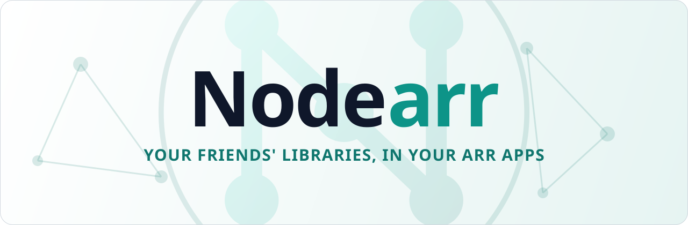

  <picture>
    <source media="(prefers-color-scheme: dark)" srcset="Logo/banner-dark.svg">
    
  </picture>

  
  
  
  

  <a href="#getting-started">Getting started</a> ·
  <a href="docs/user-guide/README.md">User guide</a> ·
  <a href="#support">Support</a> ·
  <a href="CONTRIBUTING.md">Contributing</a>

Nodearr lets a few friends who trust each other get media from one another's libraries, through the Arr apps they already run. It sits beside Sonarr, Radarr, Lidarr and Whisparr as one more indexer and download client. When your Sonarr wants an episode a friend has, it finds it in Nodearr, grabs it, and imports it like any other download. The file comes straight from your friend's machine to yours, and is checked against its hash before your Arr app sees it.

Nobody else is involved. There is no account, no server of ours that sees your library, and no relay that carries your files. Each of you runs Nodearr on your own machine, decides what the others may see, and can end a friendship at any time.

> [!NOTE]
> **Nodearr is in pre-release.** Everything it set out to do for V1 works, and has been run between machines on different home networks with no port forwarded. It has not yet been lived with for weeks. See [what is still open](docs/plans/v1-implementation-plan.md#what-is-still-open).

## Major features include

- **Nothing new to learn in your Arr apps.** Nodearr adds itself to each one as an indexer and a download client. Their searches, grabs, quality profiles, upgrades and imports work as they always have.
- **Friends by invite.** One friend creates an invite code, the other pastes it in, and the two nodes trust each other. Revoke a friend at any time.
- **Everything is shared, unless you say otherwise.** A new friend is offered your whole library, apart from what you put on the Hidden list. Or untick that for a friend and choose what they see: whole series, seasons, episodes, movies, artists or albums.
- **Browse what your friends have,** with posters from their own Arr apps, and see at a glance what they have that you are missing, or have in a better quality.
- **Send a friend something.** Pick a title and a friend. Their Nodearr offers to add it to their Arr app, filled in the way the rest of their library is, and fetch it. Someone who is not a friend yet is sent an invite with it.
- **Straight between you, and checked.** Connections are encrypted, and files go directly between the two machines, through most home routers without forwarding a port. Every file is checked against its hash before it is handed over.
- **Runs where your Arr apps run:** a Windows installer that starts in the tray or as a service, Linux and macOS packages, and a Docker image for amd64 and arm64.
- **The familiar Arr interface,** because most of Nodearr is built from Sonarr.

## What it works with

| App | What Nodearr does with it |
| --- | --- |
| **Sonarr** | Reads its series, episodes and files. Shares whole series, seasons or single episodes. Finds episodes for it by TVDB, TMDb or IMDb ID, by scene numbering, and by air date for daily shows. |
| **Radarr** | Reads its movies and files. Finds movies for it by TMDb or IMDb ID. |
| **Lidarr** | Reads its artists, albums and tracks. Shares whole artists or single albums, offers an album only when it is complete, and moves an album as a folder of tracks. |
| **Whisparr v3** (Eros) | Reads its films and scenes. Finds films by ID, and scenes by studio, release date, title and code, as Whisparr searches for them. |
| **Whisparr v2** | The same, with each site's scenes. A v2 and a v3 find each other's scenes. |
| **Prowlarr** | Adds Nodearr to Prowlarr as an indexer, so you can search it there with your others. Prowlarr holds no library, so nothing is read from it. |

Adult content from Whisparr is only ever found by Whisparr's own searches, and albums only by Lidarr's. Sonarr and Radarr never see either. Readarr is not supported: it was archived in June 2025.

## Getting started

1. **Install it.** Downloads are on the [Releases](https://github.com/Nodearr/Nodearr/releases) page:
   - **Windows:** an installer, which starts Nodearr in the tray when you sign in or as a service, or a zip.
   - **Linux and macOS:** an archive for each platform. Start it with `./Nodearr`.
   - **Docker:** `ghcr.io/nodearr/nodearr`. [`docker/docker-compose.yml`](docker/docker-compose.yml) puts it beside Sonarr and Radarr, and explains the two things that have to be right: the shared downloads folder and the networking.
2. **Open `http://localhost:6633`.** The first page takes you through connecting your Arr apps, naming your node and inviting a friend.
3. **Invite a friend,** and send them the code. Once they have redeemed it, each of you sees the other's library in **Catalog**, and your Arr apps start finding what your friend has.

The [user guide](docs/user-guide/README.md) has the rest: [installing](docs/user-guide/installing.md), [connecting your apps](docs/user-guide/connecting-apps.md), [friends and sharing](docs/user-guide/friends-and-sharing.md), and [troubleshooting](docs/user-guide/troubleshooting.md).

## How it works

1. You add your Arr apps to Nodearr. Nodearr adds itself to each one as an indexer and a download client, and reads its library.
2. You create an invite and send it to a friend. When they paste it into their Nodearr, the two nodes trust each other.
3. Each friend is offered your library, apart from what is on your Hidden list, unless you choose what they see. Or you send one friend one thing, and their Nodearr offers to add it to their app and fetch it.
4. Each node fetches what its friends share, and shows what they have that you are missing, or have better.
5. When an Arr app searches, Nodearr answers from what your friends share. When it grabs a result, Nodearr fetches the file directly from the friend who has it, checks it, and hands it to the Arr app to import.

A public relay run by [n0](https://n0.computer), who make [iroh](https://www.iroh.computer), helps two nodes find each other. It cannot read what passes through it, and files never go through it: if the two machines cannot reach each other directly, the transfer fails and says why. [Privacy and security](docs/user-guide/privacy-and-security.md) sets out what each party can see, and the [overview](docs/overview-end-to-end-design.md) how the parts fit together.

## Support

- **Something not working?** Start with [troubleshooting](docs/user-guide/troubleshooting.md). It covers the usual ones: a friend who cannot be reached, an Arr app that does not find what a friend has or does not import what arrived, a friend who sees nothing of yours, and being locked out of the web interface.
- **Bugs and feature requests** go in [GitHub Issues](https://github.com/Nodearr/Nodearr/issues). Say which version you run, on what, and with which Arr apps, and attach the log from **System > Logs** if there is one.
- **Security problems** go through [SECURITY.md](SECURITY.md), privately, not in an issue.

## Documentation

For people running Nodearr:

- [User guide](docs/user-guide/README.md): installing, connecting apps, friends and sharing, troubleshooting, every setting, backups, and privacy and security.
- [Changelog](CHANGELOG.md): what changed in each release.

For people working on it:

- [Contributing](CONTRIBUTING.md): building, testing, and how a change is made.
- [Overview](docs/overview-end-to-end-design.md): what Nodearr is and how the parts fit together.
- [Decision records](docs/adr/): why each part works the way it does, and [sequence diagrams](docs/diagrams/).
- [The V1 plan](docs/plans/v1-implementation-plan.md): what was built, in what order, and what is still open.
- [Releases](docs/guides/releases.md): what a release holds, and how one is made.
- Testing by hand: [in Nodearr's pages](docs/guides/ui-test.md), on your own or with a friend, and [between two machines](docs/guides/two-machine-test.md), also [on Windows](docs/guides/two-machine-test-windows.md).
- [Research notes](docs/research/), including [what Nodearr inherited from Sonarr](docs/research/inherited-sonarr-features.md).

## Contributing

Contributions are welcome. [CONTRIBUTING.md](CONTRIBUTING.md) has what you need to build Nodearr (.NET 10, Node.js 20 with Yarn 4, and Rust for the transport sidecar), run its tests, and what a change includes. A change of design starts as a decision record, so read the ones for the part you want to change first.

## Licence and acknowledgements

Nodearr is licensed under [GPL-3.0](LICENSE).

It stands on the work of others:

- **[Sonarr](https://github.com/Sonarr/Sonarr)**, from which most of Nodearr's backend and web interface is derived, and **[Prowlarr](https://github.com/Prowlarr/Prowlarr)**, from which its Arr Apps settings are adapted. Both are GPL-3.0; see [NOTICE.md](NOTICE.md).
- **[iroh](https://www.iroh.computer)**, by [n0](https://n0.computer), which does the networking between nodes, and the relays n0 runs.
- The other open-source software a release carries, each under its own licence, listed in [THIRD-PARTY-NOTICES.md](THIRD-PARTY-NOTICES.md).

Nodearr is not affiliated with or endorsed by the Sonarr, Radarr, Lidarr, Whisparr, Prowlarr or Servarr projects.
