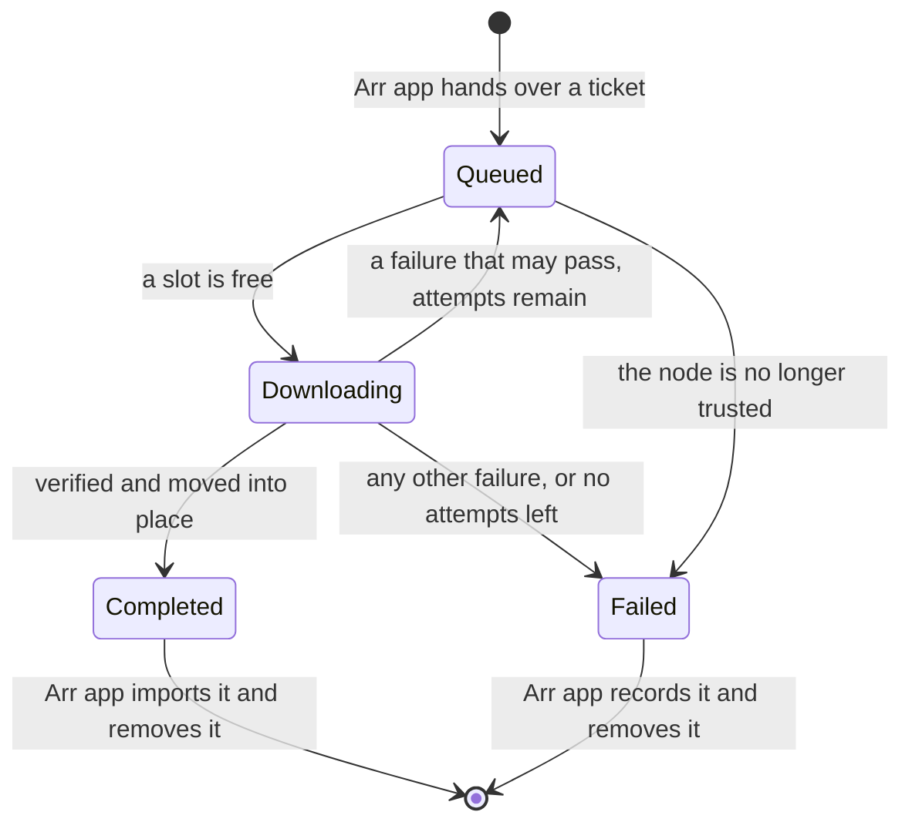

# ADR 0016: Transfers and the Download Client

## Status

Accepted. Built and checked in S7 on 2026-10-10.

The direct-only rule this builds on (ADR 0011) was accepted on 2026-10-13, after runs between two machines on different networks. Everything in this ADR's own evidence was run with both nodes on one machine.

## Context

After S6 a Sonarr or Radarr could find what a trusted node shares and fetch a ticket for it. Nothing happened next: the download client was still the S1 stub. S7 had to make a grab end in an import: fetch the file from the other node, be sure it is the right file, hand it to the Arr app, and report honestly when any of that fails.

## Decision

### Who does what

- **The transport sidecar** moves the bytes and checks them. It also enforces the direct-only rule.
- **Nodearr** decides what to fetch and from whom, keeps the record, and answers the Arr apps.
- **The sending node's Nodearr** decides, for every request, whether the asking node may have the file.

### The transfer protocol

A second protocol on the same Iroh endpoint, `nodearr/transfer/1`, beside the control protocol.

1. The node that wants the file connects and sends the peer's ID for the file, how many bytes it already holds, and the hash those bytes came from.
2. The sending sidecar asks its Nodearr. Nodearr answers with a path on disk, or refuses.
3. The sidecar works out the file's size and BLAKE3 hash, then sends a header with both. The hash is fixed before any data moves. It is cached for as long as the file's size and modified time stay the same.
4. The file follows, from the start or from where the receiver left off.
5. The receiver hashes as it writes and compares at the end.

File data moves only while the connection's selected path is a direct IP path. The sender waits up to 20 seconds for one and gives up with `NoDirectRoute` if none appears. If the path stops being direct part way, it resets the stream so nothing queued is sent again over a relay, and gives up with `DirectPathLost`. The receiver refuses data that arrives over anything else. This is the S2 spike's code, moved into the sidecar.

### Permission is asked every time

The sending node checks each request when it arrives:

1. Is the asking node trusted right now?
2. Is this file in what that node is offered right now? This is the same rule that builds the offer (ADR 0014), asked again.
3. Can the file be read here? The Arr app's path goes through the path mappings.

Having been offered a file earlier earns nothing. A resumed transfer is a new request and is checked again.

When trust ends, in either direction, the node cuts every upload to the other node at once and fails every download from it.

A transfer already under way is not cut when the file is only unshared, as opposed to trust ending. The check is per request.

### Resuming

What has arrived stays on disk when a transfer stops for a reason that may pass. The next attempt says how many bytes it holds and which hash they belong to. The sender carries on from there only if its file still has that hash. Otherwise it starts again from the beginning. The receiver reads what it holds back into the hash, so the final check always covers the whole file.

### Where files go

Under one download folder, by default `downloads` in the data folder:

- `incomplete/<download id>/<title>.<ext>` while a transfer arrives.
- `complete/<category>/<title>/<title>.<ext>` once it is verified.

A verified transfer's folder is moved from one to the other in one step. Nothing unverified ever appears under `complete`, which is the only folder the Arr apps are told about. A file that fails verification is deleted.

The offer carries the file's extension, such as `.mkv`, and nothing else of its name (this amends ADR 0014 again). The Arr app would not import a file with no extension.

### The life of a transfer

- Three transfers run at once. The rest wait.
- A transfer gets three attempts, 15 seconds apart.
- The record is in the database. A transfer that was under way when Nodearr stopped is picked up again when it starts, and carries on from what it holds. The same happens if only the sidecar restarts.

### Failures

Each failure has a name, and the name and a plain sentence go to the Arr app, where they appear in its history and blocklist.

| Name | Meaning | Tried again |
| --- | --- | --- |
| NoDirectRoute | The nodes could only reach each other through a relay. | Yes |
| DirectPathLost | The direct path went away part way through. | Yes |
| ConnectionLost | The connection dropped. | Yes |
| PeerUnreachable | The other node could not be reached at all. | Yes |
| NotAuthorized | The other node no longer shares this file with this node. | No |
| Revoked | Trust has ended, from either side. | No |
| Blocked | The other node has blocked this node. | No |
| NotFound | The other node no longer has the file, or cannot read it. | No |
| VerificationFailed | What arrived did not match the hash. | No |
| DiskError | The file could not be written or moved here. | No |

The plan also listed `Cancelled`. There is no such failure: a cancelled transfer is removed, which is what the Arr apps expect when they delete from the queue.

### The download client API

`/sabnzbd/api` is now real, with the same calls the stub had (ADR 0010).

- `addfile` reads the candidate ID from the ticket and queues a transfer. The same ticket twice gives the same download. A ticket for something no trusted node offers any more is refused.
- `queue` and `history` are read from the transfer record. `storage` is the transfer's folder under `complete`.
- Deleting from the queue stops the transfer and removes what had arrived. Deleting from history removes the record, and the files when asked.
- `get_config` lists every category the registered Arr apps use.

Nodearr reports paths as it sees them. When the Arr app sees the download folder somewhere else, the Arr app is told with a remote path mapping, as for any download client on another machine. With one shared `/downloads` mount in Docker none is needed.

## Evidence

- Unit tests for the life of a transfer, the permission check, the folders and the failure names, against a real SQLite database and real folders.
- `acceptance/Run-S7Transfers.ps1` runs two real nodes with real sidecars, each with its own Sonarr 4.0.20 and Radarr 6.4.4:
  - A search in Sonarr grabs, the file arrives from the other node, and Sonarr imports it. The imported file has the same SHA-256 as the original. Sonarr's history ties the grab and the import to the download ID Nodearr issued.
  - The same through Radarr.
  - While a file arrives it is under `incomplete` and nothing is under `complete`.
  - The same ticket twice gives one transfer. Deleting it from the queue leaves nothing behind.
  - Node B is killed in the middle of a transfer and started again. The transfer carries on from what had arrived, and the imported file is still correct.
  - Node A revokes trust in the middle of a transfer. It stops, Sonarr records the failure with the word `Revoked`, blocklists the release and imports nothing.

## Consequences

### Positive

- A grab in Sonarr or Radarr ends in an import with no change to either app.
- Nothing unverified reaches a library.
- Failure handling, blocklisting and searching again come from the Arr apps.

### Negative / trade-offs

- **Hashing is on demand.** The plan called for hashing in the background as well. Here the first request for a file pays for hashing it, and the receiver waits. BLAKE3 is fast, but a very large file on a slow disk will take a while to start.
- **Checking permission rebuilds the peer's whole offer** for each request. Fine for now. A large library will want a direct check.
- **Unsharing does not stop a transfer already under way.** Ending trust does.
- **A failed verification is not tried again**, though a file that changed while it was being sent would pass the second time.
- **No speed limit setting in the UI.** There is an upload limit option, used by the acceptance script.
- **Whole-file hash.** A resumed transfer has to read back what it already holds.

## Follow-up work

- S8: package the sidecar, the image and the shared `/downloads` layout, and run all of this between two machines on different networks, including a transfer with no direct route.
- Later: background hashing.

## Amendments

- 2026-10-11: **uploads are shown.** The sidecar keeps a record of each file it sends, from the moment Nodearr allows it: who to, which file, how far along, and how it ended. Nodearr reads that once a second, and the Transfers page has a "Sending" section beside "Receiving", updated live. An upload ends as sent, stopped (the other side went away or cancelled), cut because trust ended, or failed for want of a direct route. A request that was refused never becomes an upload and is not listed. It is logged. The list is kept in memory: it holds the last hundred finished uploads and starts empty when Nodearr starts. Nothing is decided here. Whether a node may have a file is settled before the upload begins.
- 2026-10-11 (ADR 0019): the upload limit and the download folder have a settings page.
