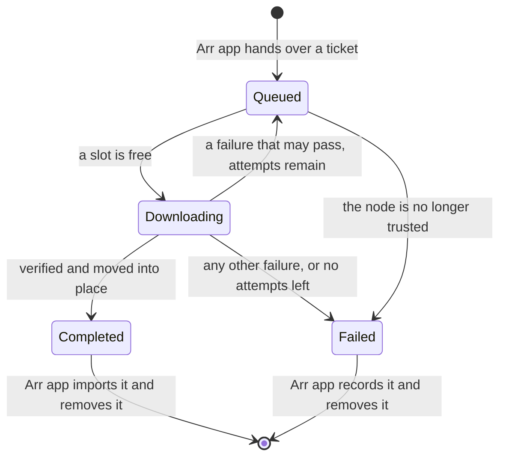

# ADR 0016: Transfers and the Download Client

## Status

Accepted. Built and checked in S7 on 2026-10-10.

The direct-only rule this builds on (ADR 0011) was accepted on 2026-10-13, after runs between two machines on different networks. Everything in this ADR's own evidence was run with both nodes on one machine.

## Context

After S6 a [Sonarr](https://sonarr.tv/) or [Radarr](https://radarr.video/) could find what a trusted node shares and fetch a ticket for it. Nothing happened next: the download client was still the S1 stub. S7 had to make a grab end in an import: fetch the file from the other node, be sure it is the right file, hand it to the Arr app, and report honestly when any of that fails.

## Decision

### Who does what

- **The transport sidecar** moves the bytes and checks them. It also enforces the direct-only rule.
- **Nodearr** decides what to fetch and from whom, keeps the record, and answers the Arr apps.
- **The sending node's Nodearr** decides, for every request, whether the asking node may have the file.

### The transfer protocol

A second protocol on the same [Iroh](https://www.iroh.computer/) endpoint, `nodearr/transfer/1`, beside the control protocol.

1. The node that wants the file connects and sends the peer's ID for the file, how many bytes it already holds, and the hash those bytes came from.
2. The sending sidecar asks its Nodearr. Nodearr answers with a path on disk, or refuses.
3. The sidecar works out the file's size and [BLAKE3](https://github.com/BLAKE3-team/BLAKE3) hash, then sends a header with both. The hash is fixed before any data moves. It is cached for as long as the file's size and modified time stay the same.
4. The file follows, from the start or from where the receiver left off.
5. The receiver hashes as it writes and compares at the end.

File data moves only while the connection's selected path is a direct IP path. The sender waits up to 20 seconds for one and gives up with `NoDirectRoute` if none appears. If the path stops being direct part way, it resets the stream so nothing queued is sent again over a relay, and gives up with `DirectPathLost`. The receiver refuses data that arrives over anything else. This is the S2 spike's code, moved into the sidecar.

### Permission is asked every time

The sending node checks each request when it arrives:

1. Is the asking node trusted right now?
2. Is this file in what that node is offered right now? This is the same rule that builds the offer (ADR 0014), asked again.
3. Can the file be read here? The Arr app's path goes through the path mappings.

Having been offered a file earlier earns nothing. A resumed transfer is a new request and is checked again.

When trust ends, in either direction, the node cuts every upload to the other node at once and fails every download from it.

~~A transfer already under way is not cut when the file is only unshared, as opposed to trust ending. The check is per request.~~ It is now: see the amendment of 2026-10-13.

### Resuming

What has arrived stays on disk when a transfer stops for a reason that may pass. The next attempt says how many bytes it holds and which hash they belong to. The sender carries on from there only if its file still has that hash. Otherwise it starts again from the beginning. The receiver reads what it holds back into the hash, so the final check always covers the whole file.

### Where files go

Under one download folder, by default `downloads` in the data folder:

- `incomplete/<download id>/<title>.<ext>` while a transfer arrives.
- `complete/<category>/<title>/<title>.<ext>` once it is verified.

A verified transfer's folder is moved from one to the other in one step. Nothing unverified ever appears under `complete`, which is the only folder the Arr apps are told about. A file that fails verification is deleted.

The offer carries the file's extension, such as `.mkv`, and nothing else of its name (this amends ADR 0014 again). The Arr app would not import a file with no extension.

### The life of a transfer

- Three transfers run at once. The rest wait.
- A transfer gets three attempts, 15 seconds apart.
- The record is in the database. A transfer that was under way when Nodearr stopped is picked up again when it starts, and carries on from what it holds. The same happens if only the sidecar restarts.

### Failures

Each failure has a name, and the name and a plain sentence go to the Arr app, where they appear in its history and blocklist.

| Name | Meaning | Tried again |
| --- | --- | --- |
| NoDirectRoute | The nodes could only reach each other through a relay. | Yes |
| DirectPathLost | The direct path went away part way through. | Yes |
| ConnectionLost | The connection dropped. | Yes |
| PeerUnreachable | The other node could not be reached at all. | Yes |
| NotAuthorized | The other node no longer shares this file with this node. | No |
| Revoked | Trust has ended, from either side. | No |
| Blocked | The other node has blocked this node. | No |
| NotFound | The other node no longer has the file, or cannot read it. | No |
| VerificationFailed | What arrived did not match the hash. | Yes, from nothing (amended 2026-10-13) |
| DiskError | The file could not be written or moved here. | No |

The plan also listed `Cancelled`. There is no such failure: a cancelled transfer is removed, which is what the Arr apps expect when they delete from the queue.

### The download client API

`/sabnzbd/api` is now real, with the same calls the stub had (ADR 0010).

- `addfile` reads the candidate ID from the ticket and queues a transfer. The same ticket twice gives the same download. A ticket for something no trusted node offers any more is refused.
- `queue` and `history` are read from the transfer record. `storage` is the transfer's folder under `complete`.
- Deleting from the queue stops the transfer and removes what had arrived. Deleting from history removes the record, and the files when asked.
- `get_config` lists every category the registered Arr apps use.

Nodearr reports paths as it sees them. When the Arr app sees the download folder somewhere else, the Arr app is told with a remote path mapping, as for any download client on another machine. With one shared `/downloads` mount in [Docker](https://docs.docker.com/) none is needed.

## Evidence

- Unit tests for the life of a transfer, the permission check, the folders and the failure names, against a real SQLite database and real folders.
- `acceptance/Run-S7Transfers.ps1` runs two real nodes with real sidecars, each with its own Sonarr 4.0.20 and Radarr 6.4.4:
  - A search in Sonarr grabs, the file arrives from the other node, and Sonarr imports it. The imported file has the same SHA-256 as the original. Sonarr's history ties the grab and the import to the download ID Nodearr issued.
  - The same through Radarr.
  - While a file arrives it is under `incomplete` and nothing is under `complete`.
  - The same ticket twice gives one transfer. Deleting it from the queue leaves nothing behind.
  - Node B is killed in the middle of a transfer and started again. The transfer carries on from what had arrived, and the imported file is still correct.
  - Node A revokes trust in the middle of a transfer. It stops, Sonarr records the failure with the word `Revoked`, blocklists the release and imports nothing.

## Consequences

### Positive

- A grab in Sonarr or Radarr ends in an import with no change to either app.
- Nothing unverified reaches a library.
- Failure handling, blocklisting and searching again come from the Arr apps.

### Negative / trade-offs

- ~~**Hashing is on demand.** The plan called for hashing in the background as well. Here the first request for a file pays for hashing it, and the receiver waits. BLAKE3 is fast, but a very large file on a slow disk will take a while to start.~~ Done afterwards, see the amendments.
- ~~**Checking permission rebuilds the peer's whole offer** for each request. Fine for now. A large library will want a direct check.~~ Done afterwards: 7 ms with 66,000 files, was 0.65 s (ADR 0014, amendments).
- ~~**Unsharing does not stop a transfer already under way.** Ending trust does.~~ Done afterwards, see the amendments.
- ~~**A failed verification is not tried again**, though a file that changed while it was being sent would pass the second time.~~ Done afterwards, see the amendments.
- **No speed limit setting in the UI.** There is an upload limit option, used by the acceptance script.
- **Whole-file hash.** A resumed transfer has to read back what it already holds.

## Follow-up work

- ~~S8: package the sidecar, the image and the shared `/downloads` layout, and run all of this between two machines on different networks, including a transfer with no direct route.~~ Done: ADR 0017, and the runs between machines in ADR 0011.
- ~~Later: background hashing.~~ Done, see the amendments.

## Amendments

- 2026-10-11: **uploads are shown.** The sidecar keeps a record of each file it sends, from the moment Nodearr allows it: who to, which file, how far along, and how it ended. Nodearr reads that once a second, and the Transfers page has a "Sending" section beside "Receiving", updated live. An upload ends as sent, stopped (the other side went away or cancelled), cut because trust ended, or failed for want of a direct route. A request that was refused never becomes an upload and is not listed. It is logged. The list is kept in memory: it holds the last hundred finished uploads and starts empty when Nodearr starts. Nothing is decided here. Whether a node may have a file is settled before the upload begins.
- 2026-10-11 (ADR 0019): the upload limit and the download folder have a settings page.
- 2026-10-13: **unsharing stops what is already being sent.** Whenever sharing changes, and whenever the library is refreshed from an Arr app, the sending node asks the sharing rule again about every upload under way, including one still being hashed. An upload of a file the receiving node is no longer offered is cut at once with `NotAuthorized`, the same name a refused request gets. The receiving node fails the transfer without trying again, removes what had arrived, and tells the Arr app, which blocklists the release. The sending node lists the upload as failed with `NotAuthorized`. An upload to a node that is no longer trusted is cut too, as `Revoked`, in case ending trust did not reach the transport. Whether the file can still be read is not asked again: the transport already has it open. The sidecar has one more call for this, `POST /v1/uploads/{id}/stop`. Checked by unit tests and by a new step in `acceptance/Run-S7Transfers.ps1`, where node A hides the series while an episode is on its way.
- 2026-10-13: **files are hashed in the background** (plan decision 3). The sending node works out the hash of every file it offers to at least one trusted node before anyone asks for it, so a request no longer waits while a large file is read.
  - The sidecar still does the hashing, with the same code as before, through a new call, `POST /v1/hash`. Nodearr asks for one file at a time, newest first.
  - A hash is kept in Nodearr's database (`FileHashes`) with the file's size and modified time as the sidecar saw them, in nanoseconds. It is kept while the file is shared, and for 30 days after.
  - Nodearr hands the kept hash back with every grant. The sidecar uses it only while the file's size and modified time still match, and otherwise hashes the file there and then, as before. So a hash survives restarts of Nodearr and of the sidecar, and a file is read again only when it changes.
  - A request and the background never read the same file at once. Whichever comes second waits for the first and takes its answer.
  - A file with no hash yet waits while this node is sending anything, so the background reading does not slow an upload. A file already hashed is checked even then, since checking reads nothing.
  - A pass runs shortly after Nodearr starts, when the library is refreshed, when sharing changes, when a node becomes trusted, and otherwise every six hours, which finds files changed in place. If the sidecar is not running, the pass stops and is tried again a minute later.
  - The Sharing page has a "Preparing Shared Files" section showing how many shared files are ready, which file is being read, and whether hashing is waiting for an upload. `GET /api/v5/sharing/hashing` gives the same.
  - What a wrong stored hash would do: the sidecar trusts it while size and modified time match, so a file changed without either changing would be sent with a hash it does not match. The receiver would fail it with `VerificationFailed` and not import it. Nothing wrong reaches a library. (Since then such a transfer is tried again with a fresh hash, see below.)
- 2026-10-13: **a failed verification is tried again.** It used to end the transfer at once, and the Arr app blocklisted the release. With hashes kept from before (the amendment above), the likely cause is the sending node's own: a file that changed without its size or modified time changing, sent with the hash it had before. Another attempt with a fresh hash would pass, so one is made.
  - The receiving node treats `VerificationFailed` as a failure that may pass, within the same three attempts. Nothing of what arrived is kept, and the next attempt asks for the file from the start, without the old hash.
  - The sending node is told by the receiver's one-byte verdict. Its sidecar forgets the hash it had for the file, and Nodearr deletes the kept one, so the next request has the file hashed afresh.
  - The Arr app hears of a failure only if every attempt fails. A file that never matches still ends as `VerificationFailed` and is blocklisted.
  - Checked by unit tests, and by a step in `acceptance/Run-S7Transfers.ps1`: one byte of an episode on node A is changed in place, its modified time set back, and node B grabs it. The first attempt fails verification, the second brings the changed file, and Sonarr imports it with no failure in its history.
  - A trusted node can make the sending node read a file again by claiming a mismatch. That costs reading the file once more, and nothing else.
- 2026-10-14 (ADR 0014): a kept hash also records which offered file it is for, so an offer can carry the hash without looking for the file on disk.
- 2026-10-14: **a transfer carries on from another node that has the same file.** A transfer records the hash its file was offered with. When the node it is coming from fails it for a reason another node could avoid, it moves at once to another trusted node that offers a file with the same hash and size:
  - The reasons are no direct route, a direct path lost, a lost connection, a node that cannot be reached, a file no longer shared or no longer there, trust ended in either direction, or a failure the transport could not name. A file that did not match its hash is tried again from the same node first, since that node must work its hash out again. A disk error here is no node's doing.
  - What has arrived is kept, and the other node carries on from it, because it is the start of the same bytes. The hash checked at the end is the same.
  - A node that was reached directly at its last connection check is tried first. Each node is moved to once and has its own three attempts, so a transfer can never go back and forth.
  - The queue says why, and where it went: "... Carrying on from Bob, which has the same file." The Arr app hears of a failure only when every copy has failed.
  - An attempt that failed is put down to the node it was with, so the connection checks look at the right node.
  - Checked by unit tests, and by `acceptance/Run-IdenticalCopies.ps1` with three real nodes: the node B was fetching from was stopped at 4.2 MB, and the transfer carried on from the other node at 4.5 MB, not from the start. Sonarr imported the right file and recorded no failure.
  - Fetching parts of one file from several nodes at once is not done. The owner left it for when identical copies turn out to be common.

- 2026-10-19: **current limits clarified.** Three attempts means the first attempt and at most two retries, with 15 seconds between retries. Switching to another identical copy gives that node its own attempts; each track of an album has its own attempts and stays with the same node. A friend returning after all attempts have failed does not restart the transfer by itself. The owner or Arr app must retry. Upload Limit is now on **Settings > Node** ([ADR 0019](0019-node-settings-saved-in-the-ui-fixed-by-the-environment.md)).

