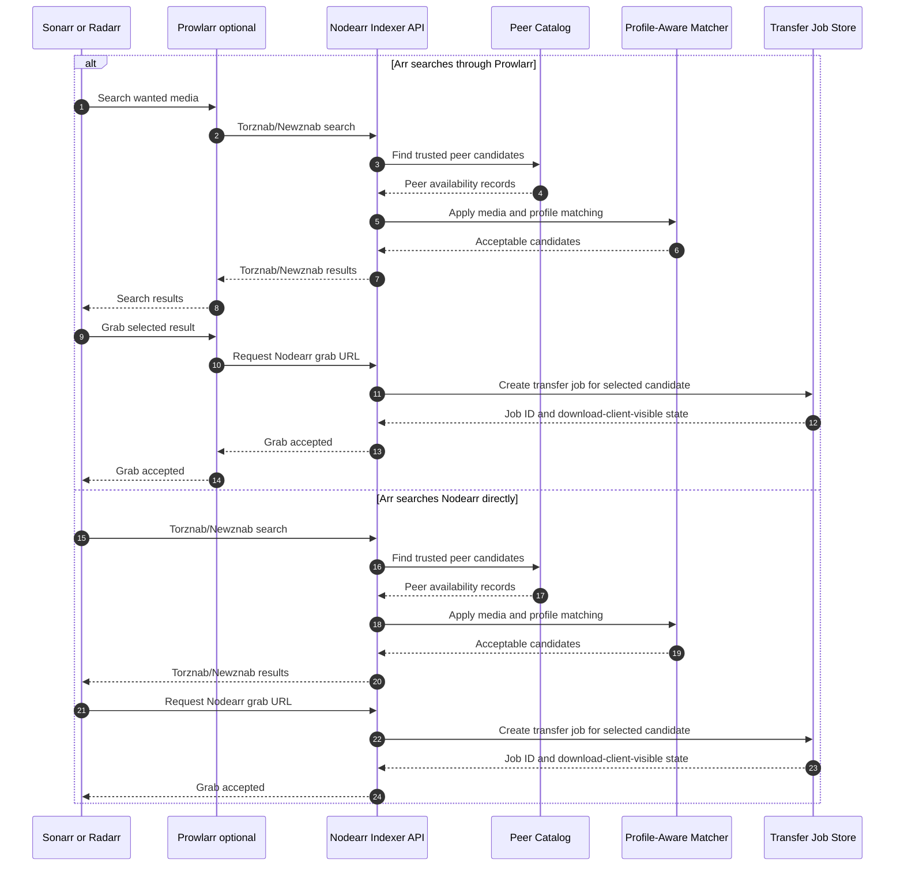

# Arr search/grab flow where Nodearr acts as indexer

Nodearr exposes peer availability as Torznab/Newznab-style search results. A grab URL creates a Nodearr transfer job; 
the indexer API itself does not move file bytes.

