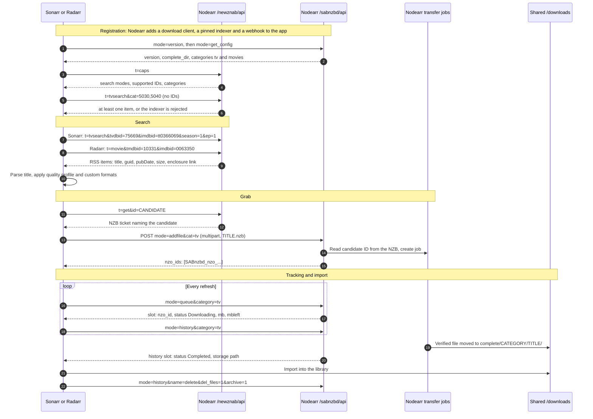
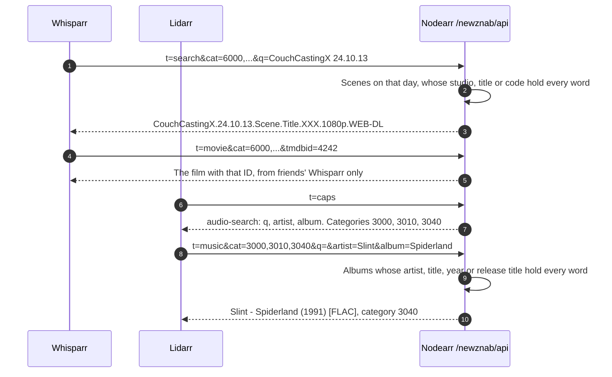
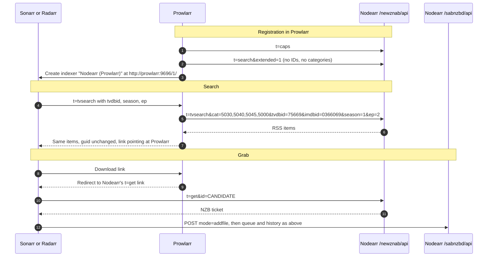
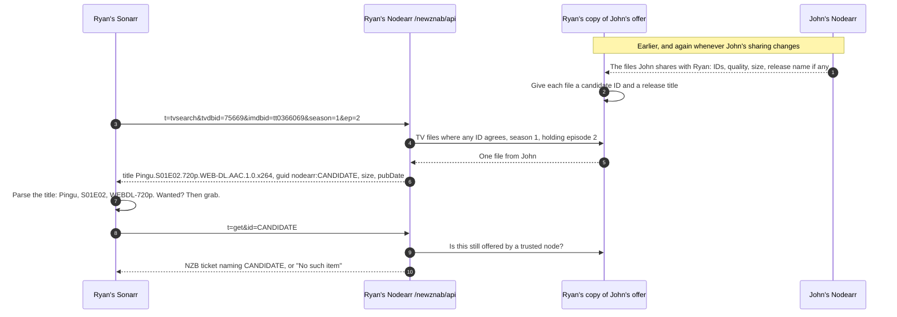
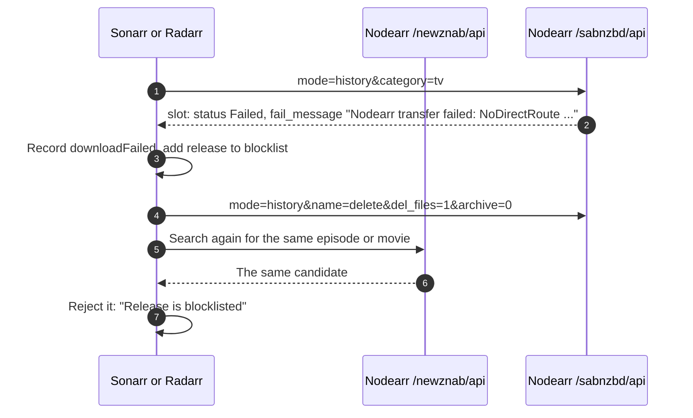

# Arr search, grab and import flow

Nodearr is a Newznab indexer and a SABnzbd-compatible download client to the Arr apps. A search returns peer candidates. A grab returns a small NZB that is only a ticket naming one candidate. The Arr app hands that ticket to Nodearr's download client surface, which is where the transfer job is created.

The messages below were first recorded in the S1 spike against Sonarr 4.0.20, Radarr 6.4.4 and Prowlarr 2.6.5, with the API key removed, and are what the real indexer and download client answer today ([ADR 0010](../adr/0010-arr-contract-newznab-indexer-and-sabnzbd-download-client.md)). Results come from what trusted nodes share, matched by ID ([ADR 0015](../adr/0015-the-indexer-id-matching-release-titles-and-candidate-ids.md)). The transfer behind a grab is in [the transfer flow](direct-transfer-download-client-flow.md).

Each app is registered on its own categories: Sonarr on TV (5030, 5040, 5045, and 5070 for anime), Radarr on Movies (2030, 2040, 2045), Whisparr on XXX (6000 and its subcategories), and Lidarr on Audio (3000, 3010, 3040). Whisparr and Lidarr search by text, below.

## Direct: the Arr app has Nodearr as its indexer

## Searched by text: Whisparr's scenes and Lidarr's albums

A scene and an album have no ID the app can send, so these apps search by text, and Nodearr matches every word against what friends share. Only these categories ever find adult content or albums ([ADR 0015](../adr/0015-the-indexer-id-matching-release-titles-and-candidate-ids.md), amendments, and [ADR 0020](../adr/0020-lidarr-albums-shared-and-moved-as-folders-of-tracks.md)).

## Through Prowlarr

Nodearr adds itself to Prowlarr as an indexer, so it can be searched there with the user's others. Prowlarr copies it into each app it manages, and Nodearr switches those copies off, because they are not pinned to Nodearr's download client: the apps use the indexer Nodearr adds to them directly ([ADR 0007](../adr/0007-prowlarr-as-downstream-indexer-consumer.md), amendments).

What follows is the S1 spike's record of a search relayed through such a copy. The Arr app still fetches the ticket from Nodearr itself, because Prowlarr answers the download link with a redirect by default, and it still uses Nodearr as its download client.

## Where a search result comes from

Nothing in the answer names John or John's file. The candidate ID is a keyed hash only Ryan's Nodearr can produce or look up.

## Failed transfer

