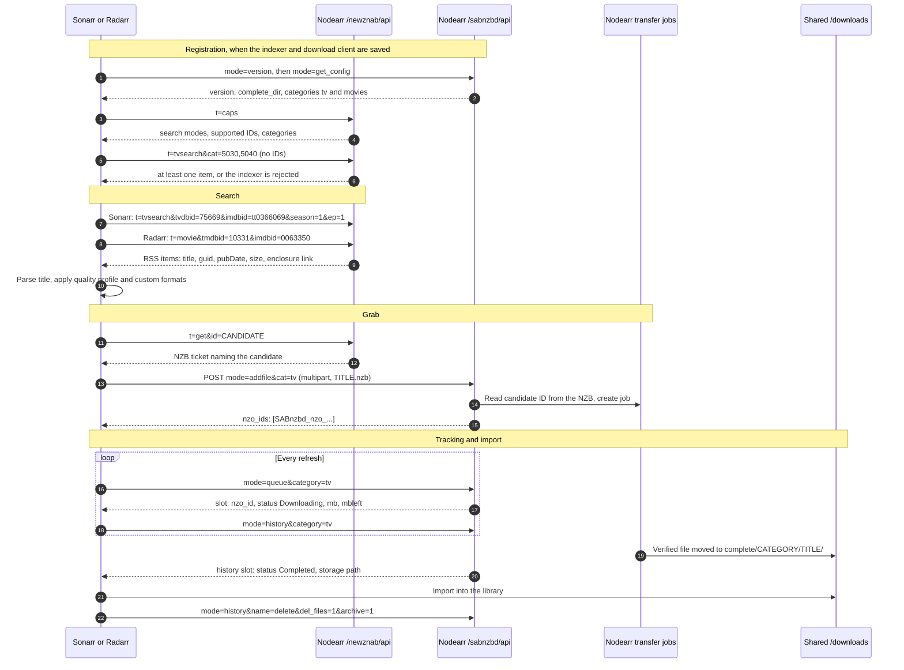
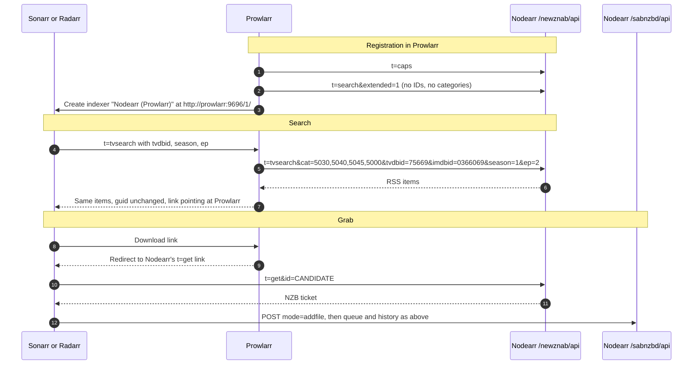
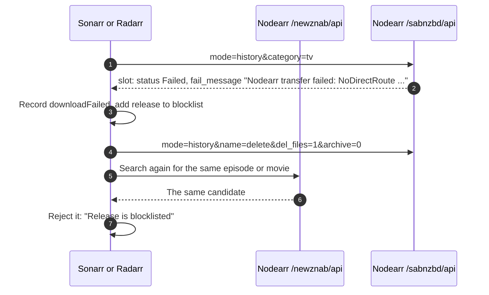

# Arr search, grab and import flow

Nodearr is a Newznab indexer and a SABnzbd-compatible download client to the Arr apps. A search returns peer candidates. A grab returns a small NZB that is only a ticket naming one candidate. The Arr app hands that ticket to Nodearr's download client surface, which is where the transfer job is created.

The messages below are the ones recorded in the S1 spike against Sonarr 4.0.20, Radarr 6.4.4 and Prowlarr 2.6.5, with the API key removed. See [ADR 0010](../adr/0010-arr-contract-newznab-indexer-and-sabnzbd-download-client.md).

## Direct: the Arr app has Nodearr as its indexer

## Through Prowlarr

Prowlarr relays the search. The Arr app still fetches the ticket from Nodearr itself, because Prowlarr answers the download link with a redirect by default, and it still uses Nodearr as its download client.

## Failed transfer

