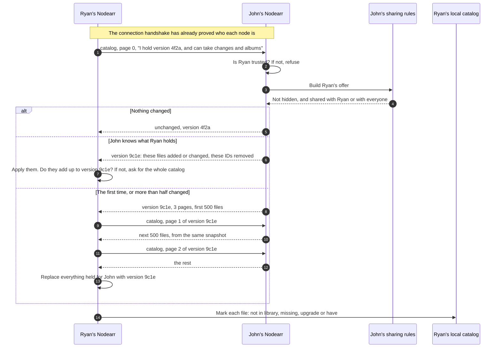
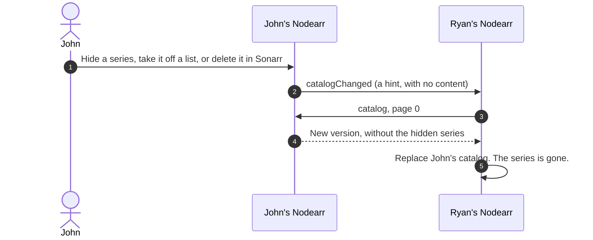
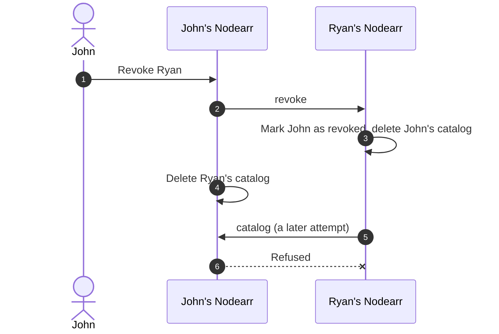

# Catalog exchange between trusted nodes

A trusted node asks another for its catalog and is answered with the offer built for it alone. No media bytes move, and nothing about where files are stored is sent. Built in S5, and since 2026-10-14 only what changed is sent after the first time. See [ADR 0014](../adr/0014-sharing-rules-and-catalog-exchange.md).

## Fetching a peer's catalog

Each file carries a fingerprint of what is said about it, and the version is worked out from the fingerprints, so a node can check that what it holds is what it was offered. A node that does not say it can take albums, an older one, is offered none.

## When something is taken back

Only taking something back is announced. What is newly shared waits for each friend's next fetch: every Catalog Sync Interval, 15 minutes by default, or when they press **Sync Peer Catalogs**. A missed hint likewise only delays the update until then.

## When trust ends

