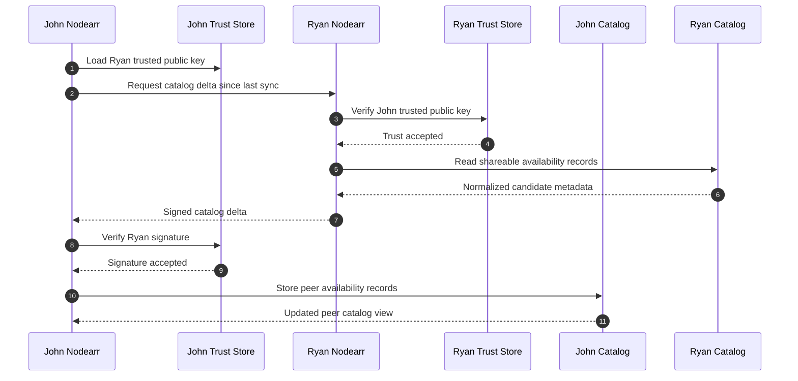

# Catalog exchange between trusted nodes

Trusted Nodearr instances exchange normalized availability metadata. Catalog exchange does not transfer media bytes and should not require peers to reveal unrelated private state.

