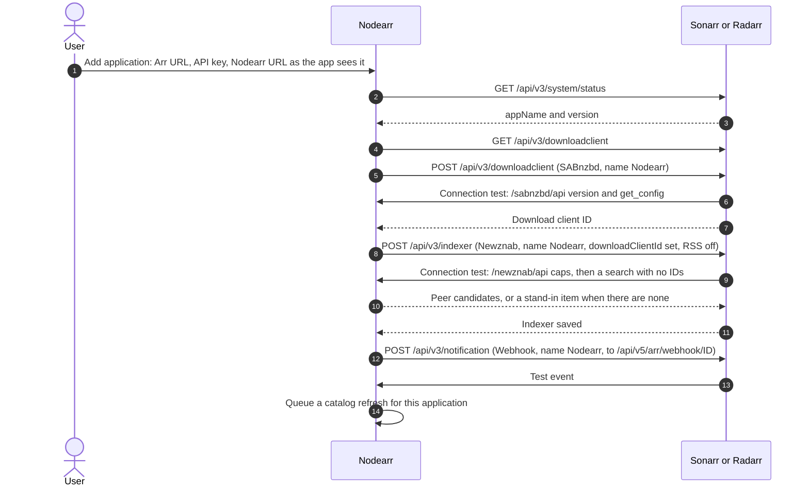
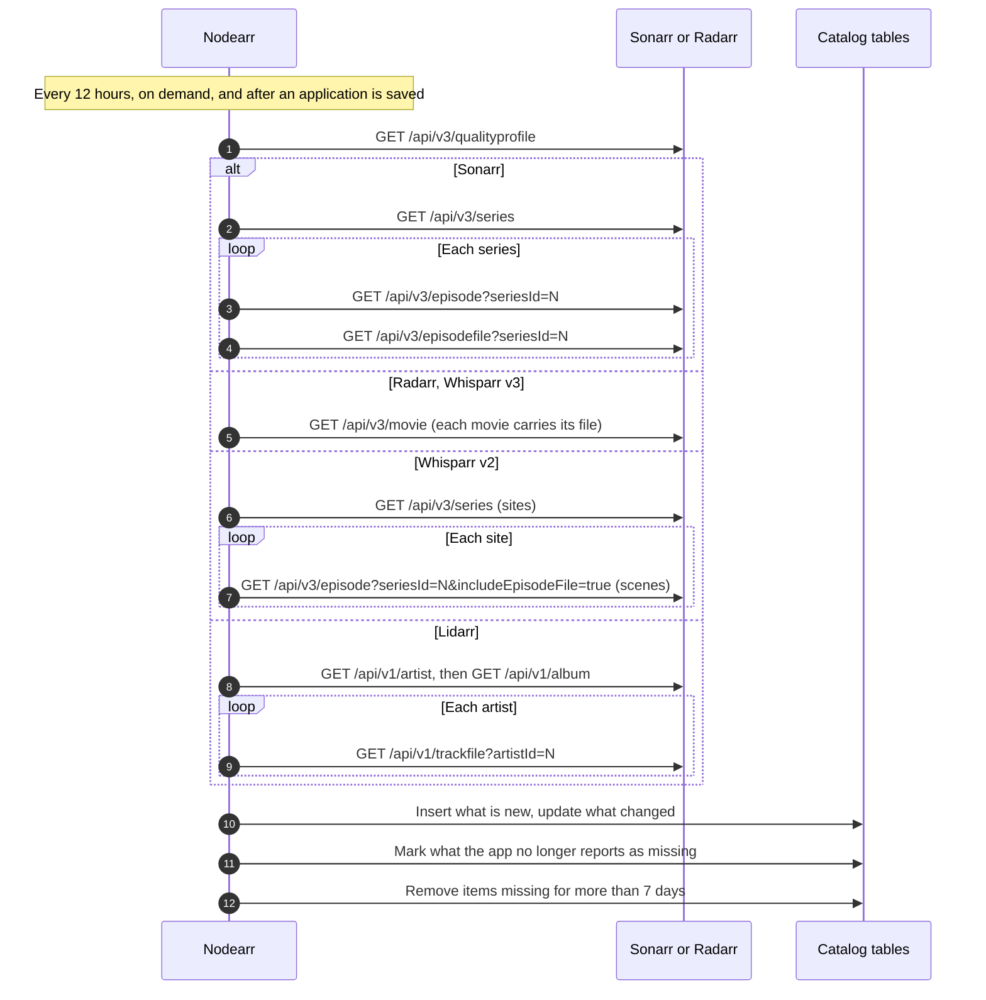
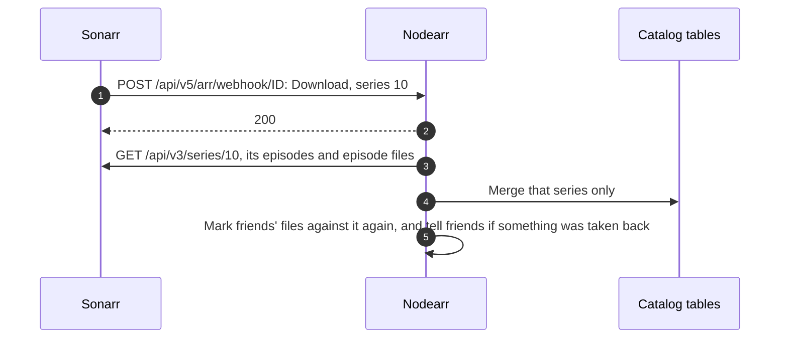

# Catalog import from the Arr apps

Adding an Arr app to Nodearr does two things. Nodearr registers itself inside the app as a download client, a pinned indexer and a webhook, and it imports the app's library into the local catalog. The Arr apps stay the source of truth for media identity, library membership, paths, quality and profiles ([ADR 0006](../adr/0006-arr-apps-as-catalog-source-of-truth.md)).

Built in S3 for Sonarr and Radarr and checked by `acceptance/Run-S3CatalogImport.ps1`. Whisparr and Lidarr are read the same way, through their own APIs, below.

## Adding an application



A sync every 6 hours repeats the lookups and only writes when something differs. With Full Sync it puts back anything changed by hand.

## Refreshing the catalog



If the app cannot be read, nothing is marked missing and the error is recorded against the application.

A file that holds several episodes is one row in `CatalogEpisodeFiles`. Each of its episodes in `CatalogEpisodes` points at it.

## When the app changes something

The webhook names the series, movie or artist an event was about, and only that title is read again, within seconds. Whisparr v2 names a site, not a scene, so its whole library is read again.



## Reading the files

The catalog stores each file's path as the Arr app reports it. When Nodearr needs the file itself, it applies the path mappings, which are keyed by the Arr app's host:

```text
Sonarr reports   /tv/Pingu/Season 1/Pingu.S01E01.mkv
Path mapping     host 127.0.0.1, /tv/  ->  D:\Media\TV\
Nodearr reads    D:\Media\TV\Pingu\Season 1\Pingu.S01E01.mkv
```

The Local Catalog page shows whether each file is readable at its mapped path.
