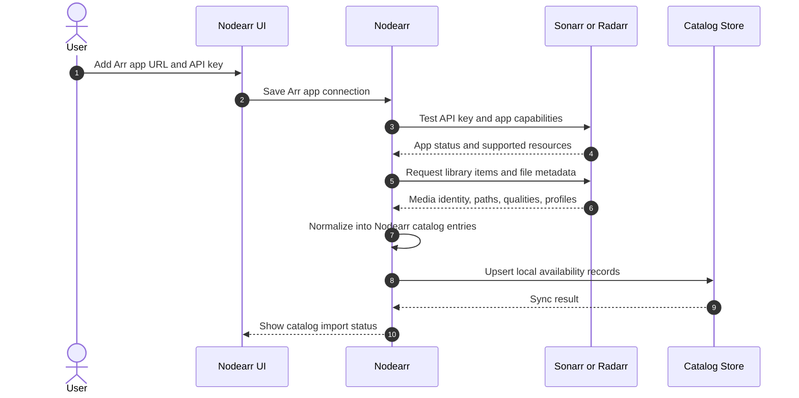

# Catalog import from Sonarr/Radarr

Nodearr imports catalog data from configured Arr applications. Sonarr and Radarr remain the source of truth for media identity, library membership, paths, quality/profile data, and import workflow state.

