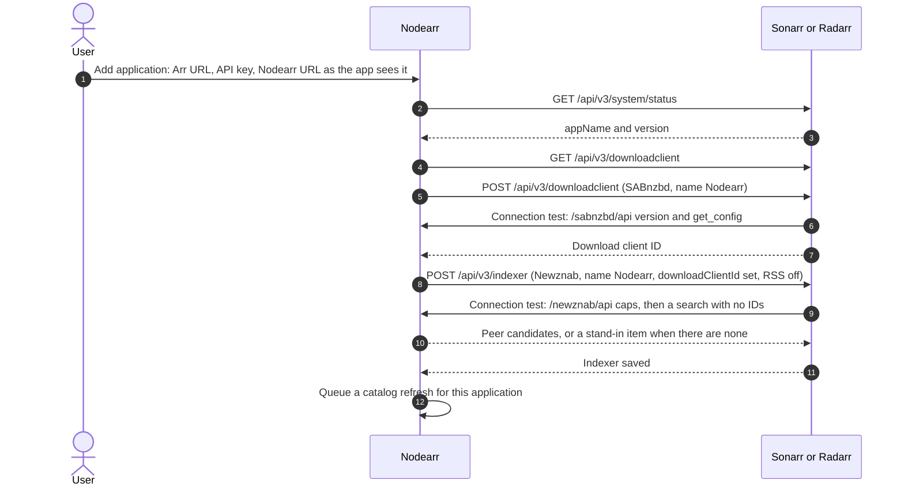
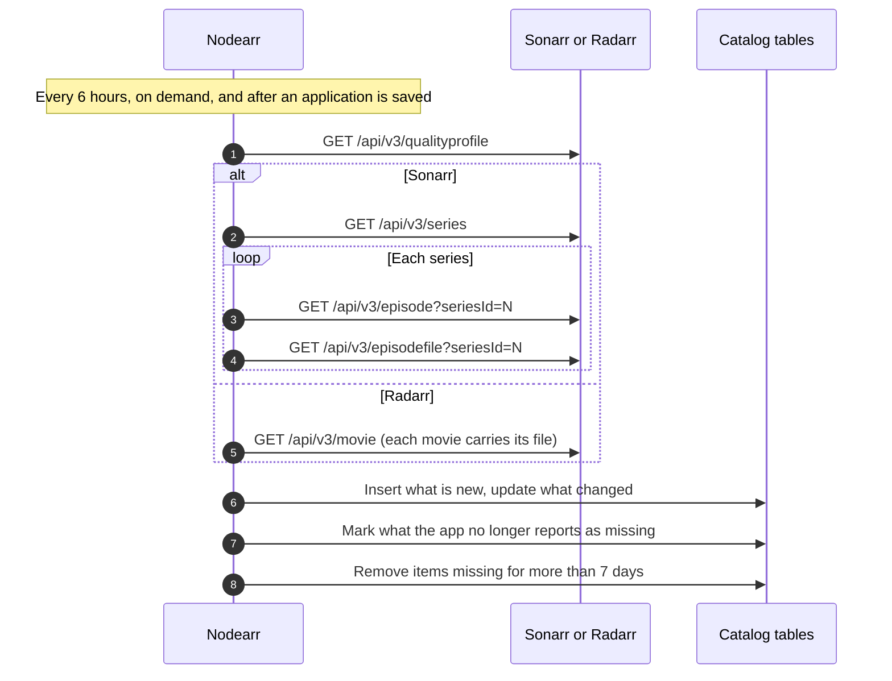

# Catalog import from Sonarr and Radarr

Adding an Arr app to Nodearr does two things. Nodearr registers itself inside the app as a download client and a pinned indexer, and it imports the app's library into the local catalog. Sonarr and Radarr stay the source of truth for media identity, library membership, paths, quality and profiles.

This is the flow as built in S3 and checked by `acceptance/Run-S3CatalogImport.ps1`.

## Adding an application



A sync every 6 hours repeats the two lookups and only writes when something differs.

## Refreshing the catalog



If the app cannot be read, nothing is marked missing and the error is recorded against the application.

A file that holds several episodes is one row in `CatalogEpisodeFiles`. Each of its episodes in `CatalogEpisodes` points at it.

## Reading the files

The catalog stores each file's path as the Arr app reports it. When Nodearr needs the file itself, it applies the path mappings, which are keyed by the Arr app's host:

```text
Sonarr reports   /tv/Pingu/Season 1/Pingu.S01E01.mkv
Path mapping     host 127.0.0.1, /tv/  ->  D:\Media\TV\
Nodearr reads    D:\Media\TV\Pingu\Season 1\Pingu.S01E01.mkv
```

The Local Catalog page shows whether each file is readable at its mapped path.
