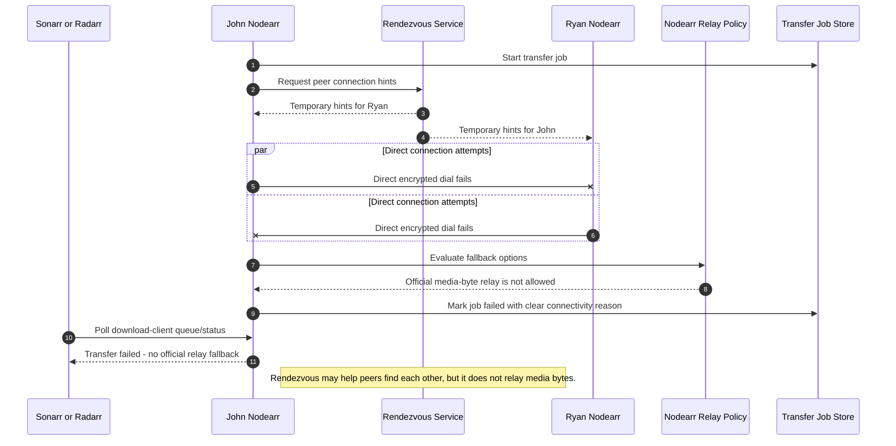

# Failure flow when direct connectivity cannot be established

If trusted peers cannot establish a direct connection, official Nodearr infrastructure does not relay media bytes. The transfer fails clearly unless the user has explicitly configured their own alternate network path.

