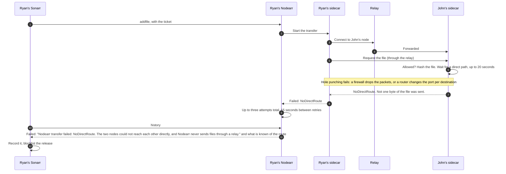
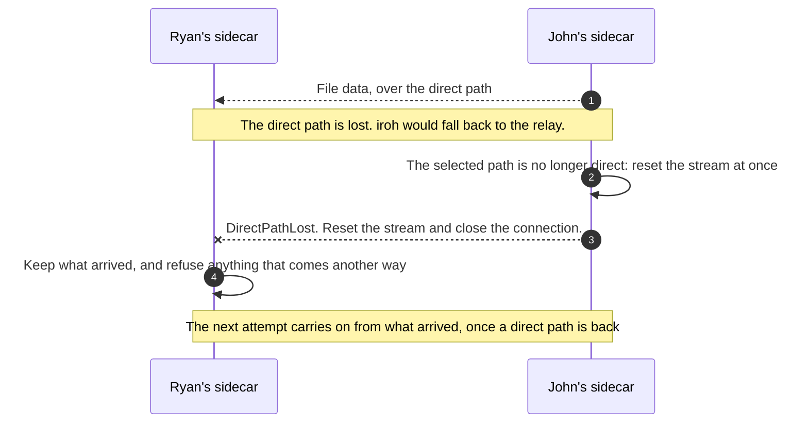

# When there is no direct path

If two nodes cannot reach each other directly, they can still talk through the relay, but no file moves: the transfer fails and says why. See [ADR 0011](../adr/0011-direct-only-media-over-iroh-with-relay-for-coordination.md) and [ADR 0016](../adr/0016-transfers-and-the-download-client.md).

## No direct path from the start

## The direct path goes away part way

**Nodes > Trusted Nodes** shows such a friend as **Relay only** after a connection check, and **System > Status** names them, with what to try: the [troubleshooting guide](../user-guide/troubleshooting.md#relay-only) goes through it.

The reset is built; counting relay bytes when a direct path is lost part way is still open in [ADR 0011](../adr/0011-direct-only-media-over-iroh-with-relay-for-coordination.md#follow-up-work).
