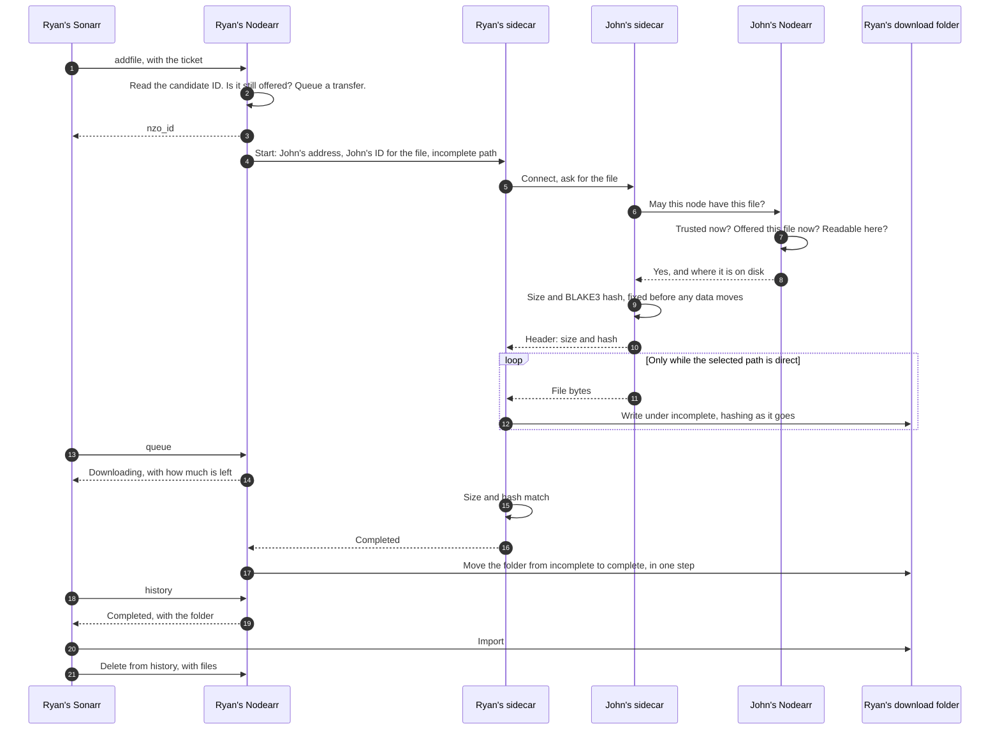
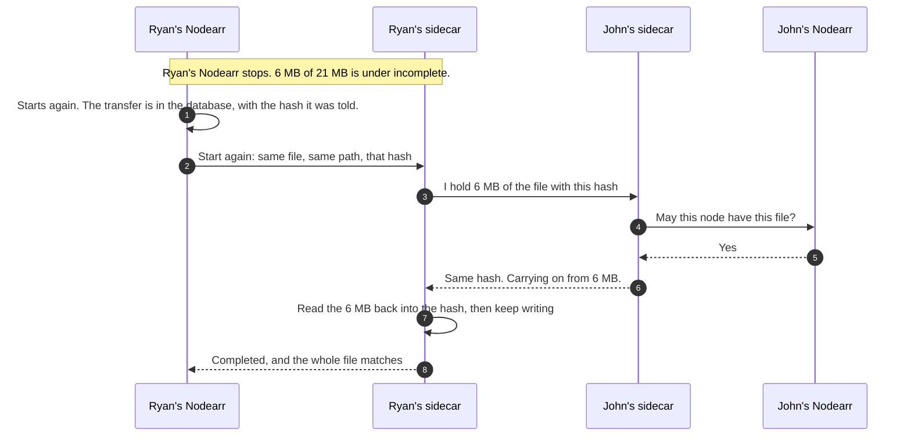
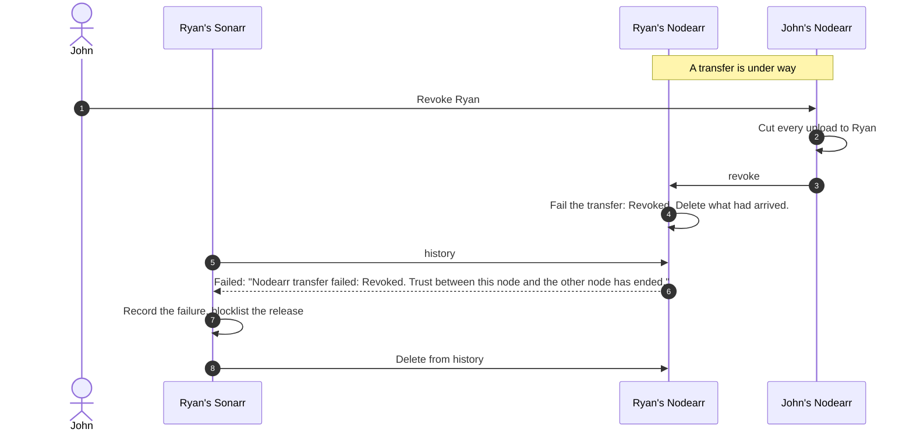
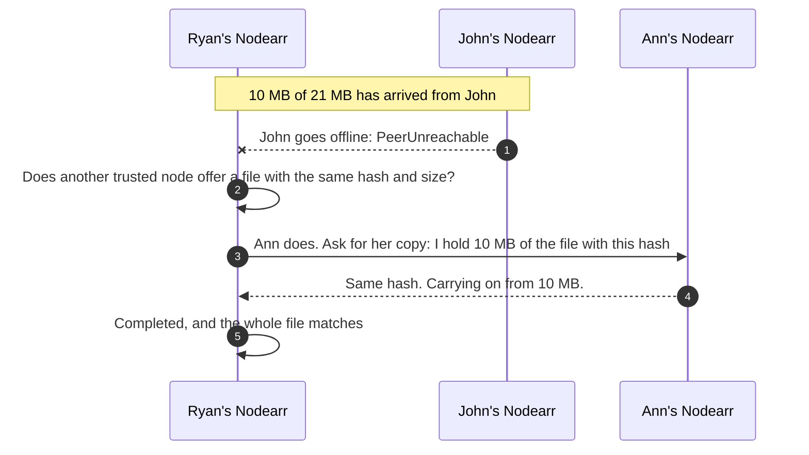

# Transfer flow, with Nodearr as the download client

After a grab, Nodearr owns the transfer. It fetches the file directly from the trusted node that shares it, checks it against the hash that node gave first, and only then puts it where the Arr app looks. This is the flow as built in S7. See [ADR 0016](../adr/0016-transfers-and-the-download-client.md).

## A transfer that works

## Restarting in the middle

If John's file had changed, the hash would differ and the sender would start from the beginning.

## When it fails

The same shape holds for every failure in ADR 0016. Those that may pass, such as a lost connection, get up to three attempts total per source node, with 15 seconds between retries, carrying on from what had arrived.

## Carrying on from another friend

Each node is moved to once, and has its own three attempts. A node that is directly reachable is tried first. A file that did not match its hash is tried again from the same node first, since it is that node that must work its hash out again.

## An album

An album from Lidarr arrives as its tracks, one transfer after another into the same folder under `incomplete`, each checked against its own hash and each with its own attempts. The folder moves into `complete` only once the last track is checked, so Lidarr never sees half an album. An album stays with the node it came from. See [ADR 0020](../adr/0020-lidarr-albums-shared-and-moved-as-folders-of-tracks.md).
