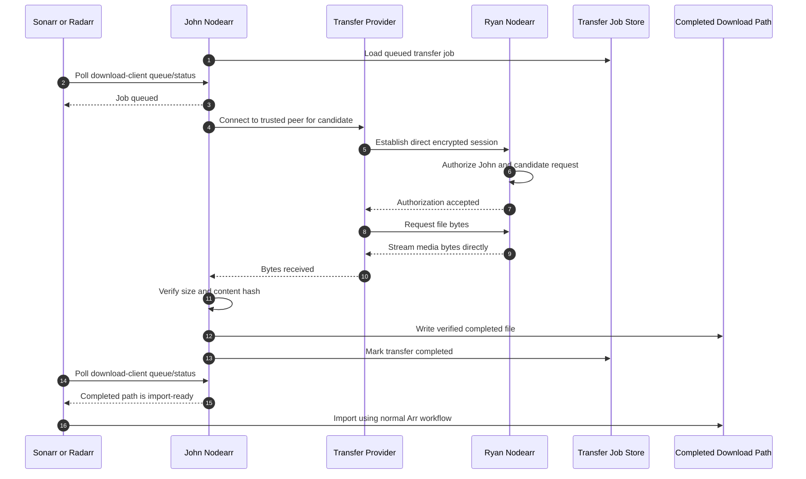

# Direct transfer flow where Nodearr acts as download client

After a grab, Nodearr owns the transfer job. It retrieves bytes directly from the trusted source peer, verifies the completed file, and exposes job state so the Arr app can import normally.

