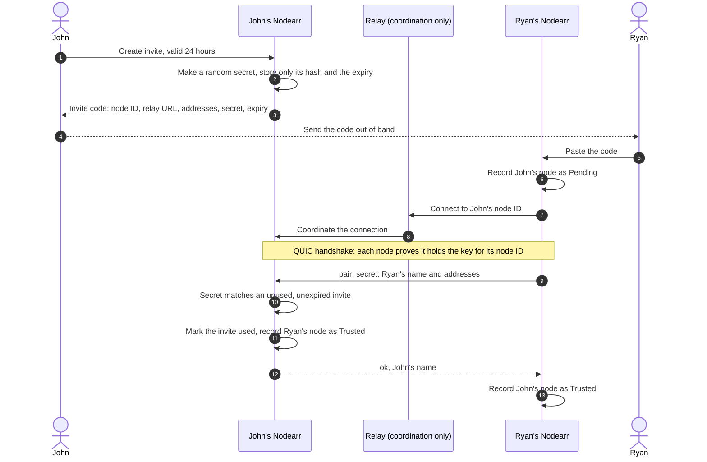
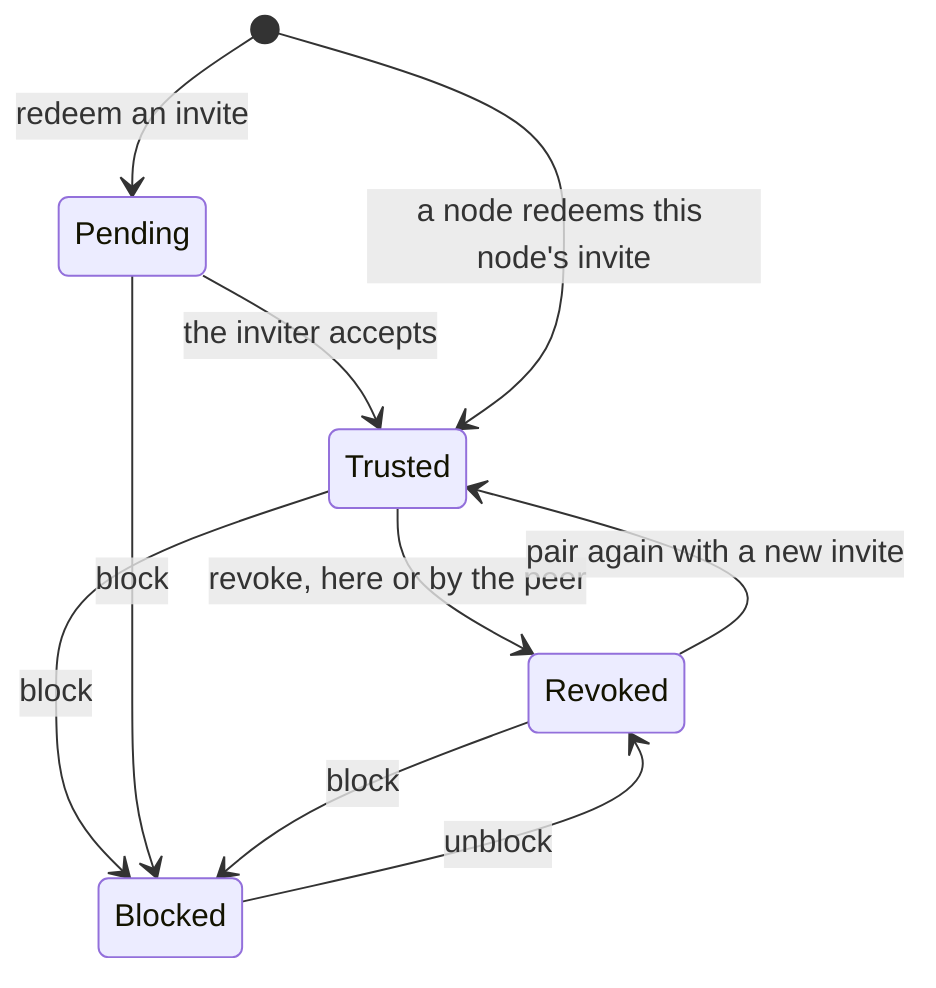
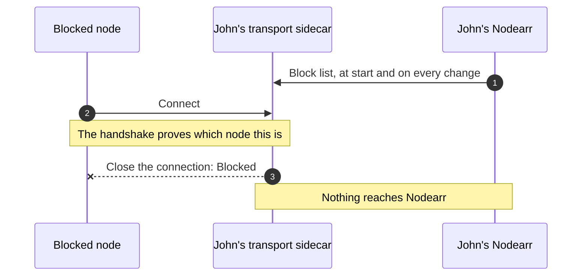

# Peer invite and trust establishment

A short-lived, one-time invite authorizes pairing. The nodes' long-lived keys establish who they are from then on. This is the flow as built in S4. See [ADR 0013](../adr/0013-node-identity-pairing-and-trust.md).

## Pairing

The relay helps the two nodes find a path to each other. It cannot read the messages and never sees the invite secret.

Every refusal says the same, `InviteInvalid`, whatever was wrong with the invite, so a stranger learns nothing by guessing. A node that has failed five times in 15 minutes is answered `TooManyAttempts` instead, without its invite being looked at, until those failures are 15 minutes old ([ADR 0013](../adr/0013-node-identity-pairing-and-trust.md), amendments).

## Trust states

## A blocked node

