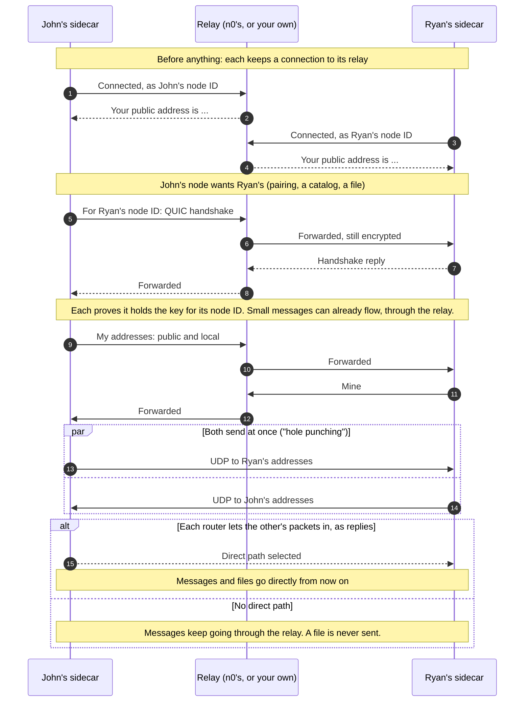

# How two nodes reach each other

Each node's sidecar keeps a connection open to its relay. The relay tells it its public address, passes on the first messages between two nodes, and helps them make a direct connection by both sending at once. Files then move only over that direct connection. See [ADR 0011](../adr/0011-direct-only-media-over-iroh-with-relay-for-coordination.md).

- The relay sees two node IDs, their addresses, and when they talk. It cannot read what passes through it.
- A sidecar also asks the router to open its port (UPnP, NAT-PMP or PCP) unless that is turned off, which makes a direct path likelier.
- With no relay (**Settings > Node**), nodes can only use addresses they already know for each other, such as on the same network or a forwarded port.
