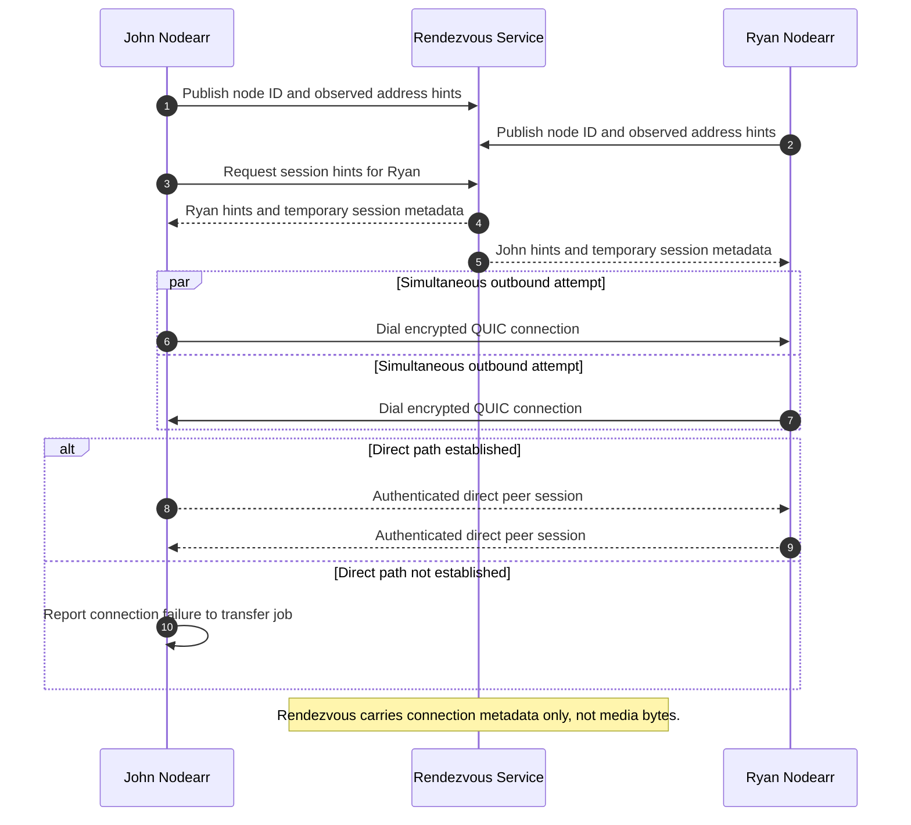

# Rendezvous-assisted direct peer connection

Rendezvous helps trusted peers find each other and exchange connection hints. The media transfer path is a direct encrypted peer connection, not an official Nodearr relay.

