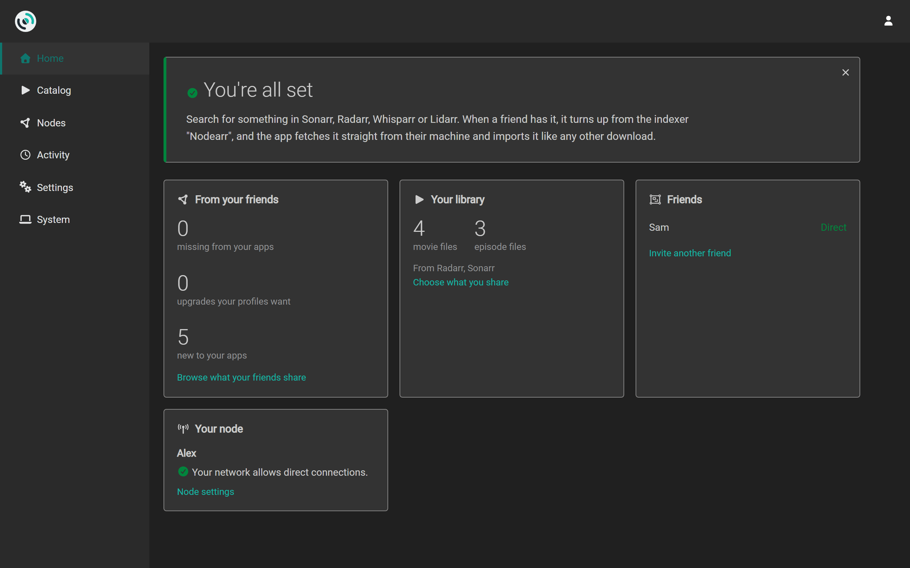

# Nodearr user guide

Use this guide to install Nodearr, connect your Arr apps and share with friends. For a new node, start with [Getting started](https://nodearr.com/getting-started/), which takes you from installation to your first search. Use the pages below for detailed instructions and reference.

- [Installing](installing.md): [Docker](https://docs.docker.com/), Windows, Linux or macOS, and the first start.
- [Connecting your apps](connecting-apps.md): [Sonarr](https://sonarr.tv/), [Radarr](https://radarr.video/), [Whisparr](https://whisparr.com/), [Lidarr](https://lidarr.audio/) and [Prowlarr](https://prowlarr.com/), and the two folders that have to line up.
- [Friends and sharing](friends-and-sharing.md): invites, trust, and choosing what each friend sees.
- [Finding and fetching](finding-and-fetching.md): what friends have, how your apps find it, and what happens to a grab.
- [Troubleshooting](troubleshooting.md): what each warning means, and what to do when a transfer fails.
- [Settings](settings.md): settings, defaults and environment overrides.
- [Backups](backups.md): what a backup holds, and moving a node to a new machine.
- [Privacy and security](privacy-and-security.md): what friends, the relay and anyone else can see.

New to Nodearr? The [project introduction](../../README.md) explains what it does. To set it up, start with [Getting started](https://nodearr.com/getting-started/); you do not need to read the design documents first.

The screenshots show two test nodes, Alex and Sam, each beside its own Sonarr and Radarr. Their folders and network addresses are examples.

## Words this guide uses

- **Node:** one running instance of Nodearr, belonging to you or a friend.
- **Friend:** a node yours trusts, because one of you used the other's invite. The UI lists them under **Nodes > Trusted Nodes**.
- **Arr app:** a library manager such as Sonarr, Radarr, Whisparr or Lidarr. Nodearr also connects to Prowlarr, which manages indexers rather than a library.
- **Offer:** a catalog of files one friend shares with your node. Each friend's offer includes only what they allow you to access.
- **Transfer:** a file being fetched from a friend after one of your Arr apps grabbed it.
- **Relay:** a server that helps two nodes find each other and can pass encrypted messages, catalogs and posters. It never carries the media your Arr apps download.
