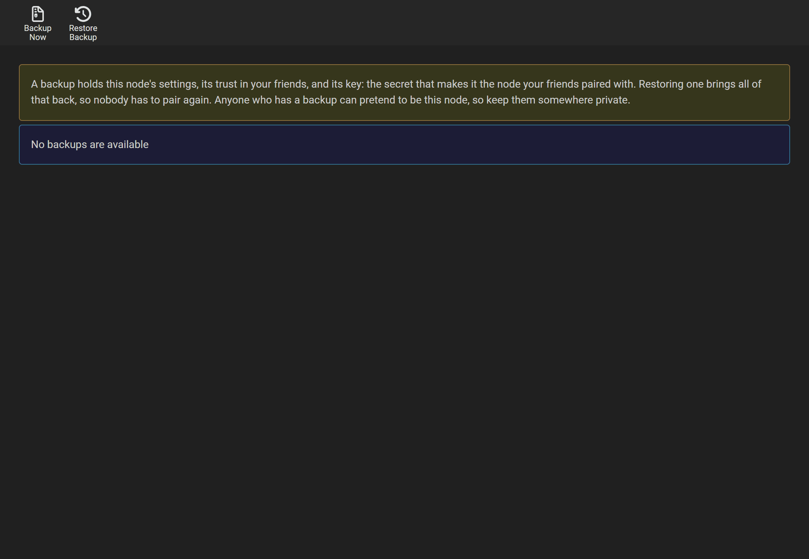

# Backups

## What a backup holds

A backup is a zip of this node's settings (`config.xml`), its database (`nodearr.db`), and its key (`node.key`). The database holds your friends, what you share with whom, your Arr apps and your transfers. The key is what makes this node the one your friends paired with.

Restoring a backup that holds the key brings all of that back, so nobody has to pair again. A backup made before the transport first started can have no `node.key`, and older backups may lack it too. Check the zip before relying on it to move a node. A node that loses its key, and has no copy of it, is a new node: each friend has to send it a new invite.

**Keep backups private.** Anyone who has one can pretend to be your node to your friends.

A backup does not hold your library or anything in the download folder. Those are your Arr apps' to keep.

## When they are made

- **Every 7 days**, kept for 28 days, in a `Backups` folder in the data folder. Change all three under Settings > General, Backups. Put the folder on another disk if you can.
- **When you press Backup Now** on System > Backup. Do that before moving the node, and before trying anything you are unsure of. Manual backups are kept until you delete them; the retention setting applies to scheduled backups.

System > Backup lists them, scheduled and manual, to download or delete.

## Restoring

On System > Backup, either press **Restore** beside one in the list, or **Restore Backup** at the top to upload one from elsewhere: a backup's `.zip`, or a database file ending in `.db` on its own. Restore only backups you made, or got from someone you trust: a backup holds settings that Nodearr acts on. Nodearr restarts with the restored settings and database. Sign in with the username and password saved in that backup. The restored key takes effect when the transport next starts, never under a running one, so the node is the one your friends know from the moment it reconnects ([ADR 0013](../adr/0013-node-identity-pairing-and-trust.md)).

## Moving a node to a new machine

1. On the old machine: **Backup Now**, download the backup, and check it holds `node.key`.
2. **Stop the old node, and do not start it again.** Two nodes with the same key confuse every friend: each would reach whichever answered first.
3. Install Nodearr on the new machine ([Installing](installing.md)), start it, and sign in.
4. **Restore Backup**, and upload the file.
5. Check Settings > Apps: an Arr app's address, or Nodearr's address as the app sees it, may be different on the new machine. Save each one, which puts Nodearr back into the app at the right address. Check the path mappings and the download folder too.
6. Check Nodes > Trusted Nodes: each friend should show as Direct again within 15 minutes, when Nodearr next checks its connections. Press Check connection to see it now.

Your friends need to do nothing.

## Docker

The data folder is `/config`. Back up the backups by keeping a copy of `/config/Backups` elsewhere, or the whole of `/config` while the container is stopped. Moving a container to another machine is the same as above: restore the backup into a new container, or move `/config` whole.

## PostgreSQL

The database in these backups is SQLite, Nodearr's default. If you use the inherited PostgreSQL option, back up and restore that database separately: Nodearr's zip does not include it. See [Settings](settings.md#postgres).
