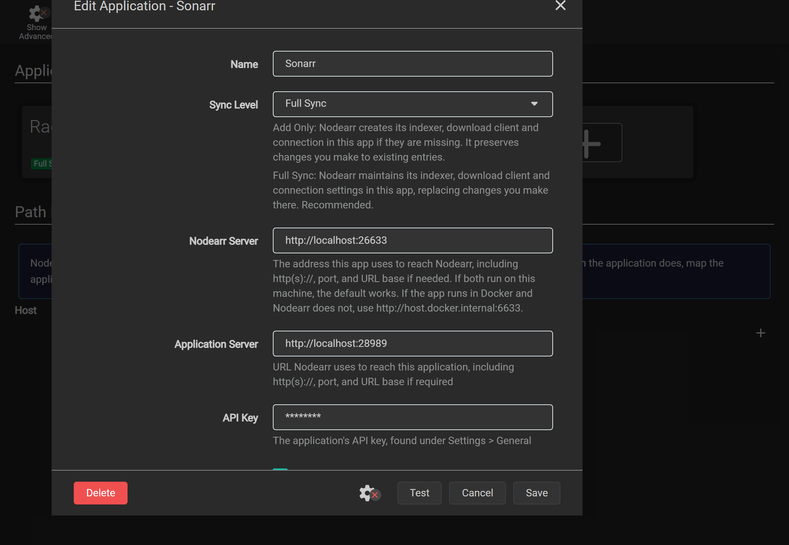
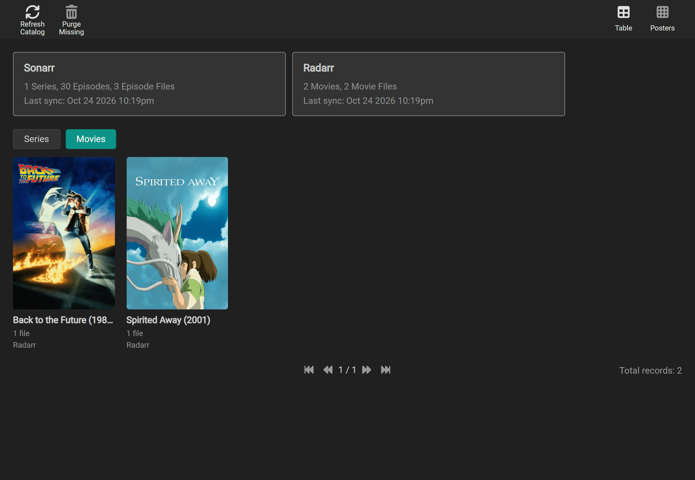

# Connecting your apps

Nodearr connects to the Arr apps you already run. It reads their libraries and registers itself as an indexer and a download client. Your apps can then find and import files shared by your friends.

## Adding an app

To connect an app:

1. In Nodearr, go to **Settings > Apps** and select **+**.
2. Choose your library app. For Whisparr, choose the connection type for the version you run. Fill in the fields described in this section.
3. Select **Test** to check the address, API key, app type and supported version.
4. Select **Save**. Nodearr registers itself in the app and imports its library. A large library can take a few minutes.

## What to fill in

<details>
<summary>See the connection form</summary>



</details>

| Field | What it is |
| --- | --- |
| **Name** | A name you choose to identify this connection in Nodearr. |
| **Sync Level** | Leave **Full Sync** selected for setup. It maintains Nodearr's indexer, download client and webhook settings in the app, replacing changes you make there. **Add Only** creates missing entries and preserves your changes to existing ones. **Disabled** stops library imports and registration updates. |
| **Nodearr Server** | The address the Arr app uses to reach Nodearr. The default works when both run on the same machine outside [Docker](https://docs.docker.com/). |
| **Application Server** | The address Nodearr uses to reach the Arr app. |
| **API Key** | The Arr app's API key, found in that app under **Settings > General**. |
| **Share With New Friends** | Includes this app's library when a friend is offered everything except **Hidden**. Applies to new friends and to existing friends when you add the app. Off by default for both [Whisparr](https://whisparr.com/) versions; on for other library apps. To change access for an existing friend, use [the per-friend app choices](friends-and-sharing.md#with-a-friend-everything-some-apps-or-lists) on **Catalog > Sharing**. |

<details>
<summary>Advanced connection fields</summary>

| Field | What it is |
| --- | --- |
| **Username**, **Password** (advanced) | Credentials for a reverse proxy that requires HTTP Basic authentication. Leave these empty if the app is not behind such a proxy. |
| **Download Category** (advanced) | The category the app uses when sending downloads to Nodearr. |
| **Sync Categories** (advanced) | The categories the app searches on Nodearr's indexer. |

</details>

The two server addresses point in opposite directions. Check both when an app runs in [Docker](https://docs.docker.com/) or on another machine.

### The defaults for each app

| App | Default address | Needs at least |
| --- | --- | --- |
| [Sonarr](https://sonarr.tv/) | `http://localhost:8989` | 3.0.5 |
| [Radarr](https://radarr.video/) | `http://localhost:7878` | 3.0 |
| Whisparr v3 | `http://localhost:6969` | 3.0 |
| Whisparr v2 | `http://localhost:6969` | 2.0, below 3.0 |
| [Lidarr](https://lidarr.audio/) | `http://localhost:8686` | 2.0 |
| [Prowlarr](https://prowlarr.com/) | `http://localhost:9696` | 1.0 |

<details>
<summary>Default download and search categories</summary>

| App | Download category | Searched in |
| --- | --- | --- |
| [Sonarr](https://sonarr.tv/) | `tv` | 5030, 5040, 5045, and 5070 for anime |
| [Radarr](https://radarr.video/) | `movies` | 2030, 2040, 2045 |
| Whisparr v3 | `whisparr` | 6000, 6040, 6045, 6080, 6090 |
| Whisparr v2 | `whisparr` | 6000, 6040, 6045, 6080, 6090 |
| [Lidarr](https://lidarr.audio/) | `music` | 3000, 3010, 3040 |
| [Prowlarr](https://prowlarr.com/) |  |  |

</details>

Choose the Whisparr version you run. Both versions use the name Whisparr, but Nodearr has separate connection types for v2 and v3. **Test** reports a version mismatch if you choose the wrong one.

## When the apps are in Docker

Inside a container, `localhost` means that container. Choose the arrangement you use. These examples use Sonarr; substitute your app's port and the service names from your Compose file.

<!-- tabs:app-network -->

### Both on the host

When both apps run directly on the same machine:

| Field | Value |
| --- | --- |
| **Nodearr Server** | `http://localhost:6633` |
| **Application Server** | `http://localhost:8989` |

### Nodearr on the host

When Nodearr runs on the machine or uses Docker's host network, and Sonarr runs in a bridge container:

| Field | Value |
| --- | --- |
| **Nodearr Server** | `http://host.docker.internal:6633` |
| **Application Server** | `http://localhost:8989`, using Sonarr's published host port |

The app's port must be published on the host. On Linux, also add this to the Arr app's service so it can resolve `host.docker.internal`:

```yaml
extra_hosts:
  - "host.docker.internal:host-gateway"
```

### Both on a bridge

When Nodearr and Sonarr use the same Docker bridge network:

| Field | Value |
| --- | --- |
| **Nodearr Server** | `http://nodearr:6633` |
| **Application Server** | `http://sonarr:8989` |

Use your Compose service names. Both containers must be on the same network for those names to resolve.

<!-- /tabs -->

## What Nodearr adds to each app

For Sonarr, Radarr, Whisparr and Lidarr, Nodearr creates three entries named **Nodearr** in the Arr app:

- A download client under **Settings > Download Clients**, using the [SABnzbd](https://sabnzbd.org/) interface and the app's download category. The app removes completed downloads from Nodearr after importing them.
- An indexer under **Settings > Indexers**, using Newznab and assigned to that download client. Automatic and interactive search are on. RSS is off by default, so the app discovers your friends' files when it searches.
- A webhook under **Settings > Connect**, which notifies Nodearr when the app imports, upgrades, renames or deletes files.

Prowlarr receives only an indexer; see [Prowlarr](#prowlarr).

Deleting a connection in Nodearr removes its imported catalog and tries to remove Nodearr's entries from the Arr app. If the app is offline, remove those entries yourself when it is available. Nodearr keeps the entries if another connection still points to that same app.

## The two folders that have to line up

### Where transfers go

The Arr app must be able to read Nodearr's completed downloads at the path Nodearr reports. Nodearr checks this through the app's file browser and reports problems on **System > Status**.

- In Docker, mount one folder at the same path, such as `/downloads`, in Nodearr and in every app.
- Outside Docker, apps on the same machine usually use the same path. The default is `downloads` in Nodearr's data folder. Change **Download Folder** under **Settings > Node** if needed.
- If the app sees that folder at a different path, add a remote path mapping in the Arr app under **Settings > Download Clients**. Map the path Nodearr reports to the path the app can read.

### When Nodearr sees the library at another path

To send a library file to a friend, Nodearr reads the path reported by the Arr app. If that path differs from the one Nodearr can read, add a path mapping in Nodearr under **Settings > Apps**, in **Path Mappings**:

| Host | Remote path | Local path |
| --- | --- | --- |
| The app's host, as in its **Application Server** address | The path the app reports, such as `/tv/` | Where Nodearr finds it, such as `D:\Media\TV\` |

Check **Catalog > Local** to see each file's path and whether Nodearr can read it. **System > Status** warns about missing files and permission problems; see [Friends are refused your files](troubleshooting.md#friends-are-refused-your-files). These files can still appear in a friend's catalog, but transfers fail until Nodearr can read them.

## Each app

Choose the app you are connecting. The connection steps and folder requirements above apply to every library app.

<!-- tabs:arr-app -->

### Sonarr

Nodearr reads every series, episode and episode file. Sonarr searches Nodearr by the IDs it knows: TVDB, TMDb and IMDb, and the season and episode. When release groups use different episode numbering, Sonarr searches with those scene numbers. Daily shows use the air date. Anime searches use category 5070 and the same series IDs and episode numbers.

You can share a whole series, a season or single episodes.

### Radarr

Nodearr reads every movie and its file. Radarr searches by TMDb and IMDb ID.

### Whisparr v3 (Eros)

Nodearr reads films and scenes, including their studio, release date, code and IDs. Whisparr v3 searches for films by TMDb ID and scenes by studio, date, title or code. It can find scenes shared by friends running either Whisparr v2 or v3, and Nodearr recognizes matching scenes across the two versions.

Adult content is found only by searches in the XXX categories, which Nodearr registers Whisparr with. Radarr's normal movie categories leave it out, even for a film it also knows. This is category filtering, not a separate key for each app.

**Share With New Friends** is off by default for Whisparr v3. To share its library, enable it for new friends or select the app for an existing friend on **Catalog > Sharing**. You can also share individual titles through lists.

For titles sent by friends, **Get it** can add films and v3 scenes to Whisparr v3. It cannot add scenes originating from Whisparr v2; add those in Whisparr yourself and search there. See [receiving a title](friends-and-sharing.md#when-a-friend-sends-you-something).

### Whisparr v2

Nodearr reads each site's scenes from Whisparr v2. Whisparr v2 searches for scenes by studio, date, title or code. It can find scenes shared by friends running either Whisparr v2 or v3, and Nodearr recognizes matching scenes across the two versions.

Adult content requires a search in the XXX categories, which Nodearr selects when registering its indexer in Whisparr v2. Radarr's normal movie categories exclude it. This restriction depends on the search categories, not the calling app's identity.

**Share With New Friends** is off by default for Whisparr v2. To share its library, enable it for new friends or select the app for an existing friend on **Catalog > Sharing**. You can also share individual scenes through lists.

Whisparr v2 webhooks identify the changed site rather than an individual scene, so Nodearr refreshes the full library after each change. Large libraries take longer to refresh.

**Get it** cannot add titles to Whisparr v2. Add the scene in Whisparr yourself, then search there for your friend's copy. See [receiving a title](friends-and-sharing.md#when-a-friend-sends-you-something).

### Lidarr

Nodearr reads artists, albums and track files. You can share a whole artist or individual albums. An album is offered only when Lidarr has every track. Nodearr transfers the tracks into one folder and makes it available for import after every track has arrived and passed verification.

Lidarr searches by artist and album, as text, in the Audio categories. Albums are found only when an Audio category is requested. An album's release title is the name Lidarr kept for the release, or `Artist - Album (Year) [Quality]`.

Track names follow Lidarr's default naming format, such as `Slint - Spiderland - 01 - Breadcrumb Trail.flac`. Multi-disc albums include the disc number, such as `1-01`. If **Rename Tracks** is off in Lidarr, it preserves those names and imports the files directly into the artist's folder. To use your own folder and file naming formats, turn on **Rename Tracks** in Lidarr under **Settings > Media Management**.

### Prowlarr

Prowlarr manages indexers rather than a media library. Connecting it adds an indexer named **Nodearr** to Prowlarr, where you can search your friends' offers alongside other indexers. Nodearr imports no library from Prowlarr.

Prowlarr's copies of the Nodearr indexer are not assigned to Nodearr's download client. Downloads through those copies could go to the wrong client and fail. To prevent this, Nodearr creates a sync profile named **Nodearr** in Prowlarr with RSS, automatic search and interactive search disabled. The indexers copied to your apps are therefore disabled.

Connect each library app directly to Nodearr using [the connection steps](#adding-an-app) at the start of this page. The app uses the indexer and download client registered by that direct connection.

<!-- /tabs -->

## Reading the library again

Nodearr refreshes each app's library every 12 hours. Webhooks trigger a refresh of the affected title within seconds; Whisparr v2 triggers a full-library refresh instead.

**Catalog > Local** has the same kind filters in **Table** and **Posters**: **Series**, **Movies**, **Music** when Lidarr is connected, and **Scenes** when Whisparr is connected. The selection is remembered on this page. In **Table**, a show opens into seasons, then episode files. A multi-episode file appears once with every episode it holds. Anime rows show absolute episode numbers; scene numbers appear alongside the TVDB numbers when they differ. Daily shows group by Sonarr's season and show the air date. Specials (season 0) appear last. Show and season rows summarize episode count, missing episodes and total size.

In **Posters**, the selected kind shows one tile per title with how many files it has. Music tiles use the album's artist and square artwork.


Choose **Movies** to see movie posters on their own:



To refresh all libraries now, go to **Catalog > Local** and select **Refresh Catalog**. Files an app no longer reports are marked missing, then removed from Nodearr's catalog after 7 days. Select **Purge Missing** to remove those catalog entries immediately.


