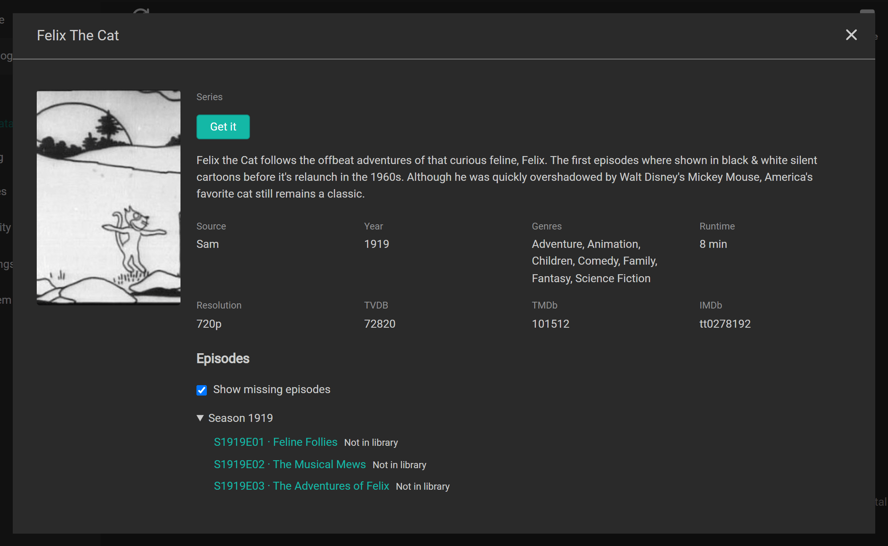
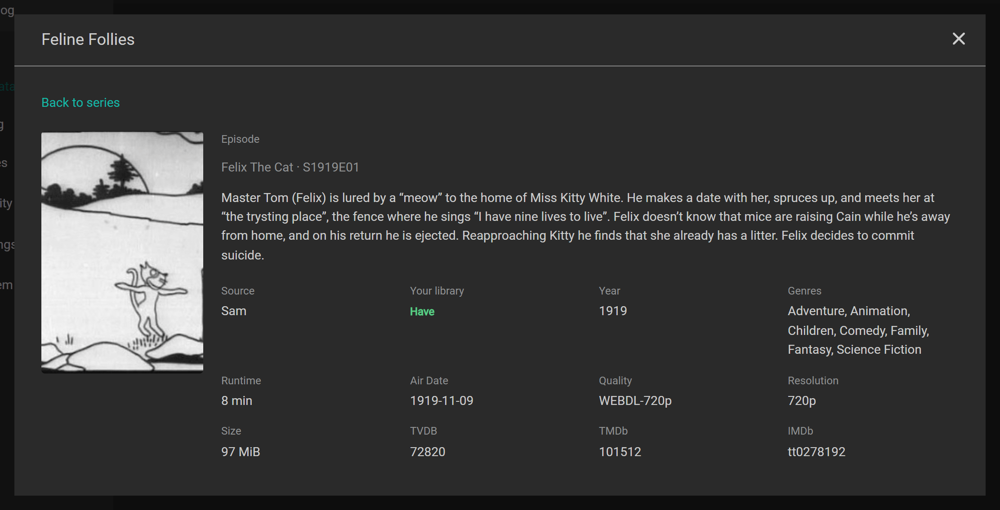
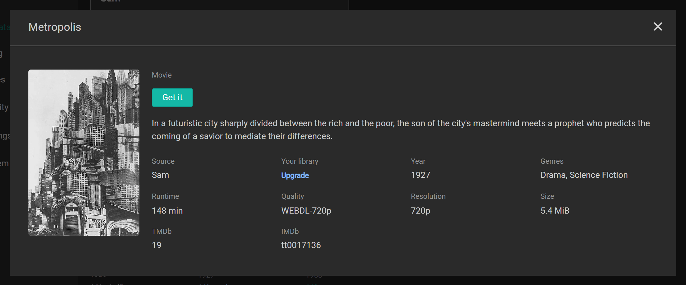
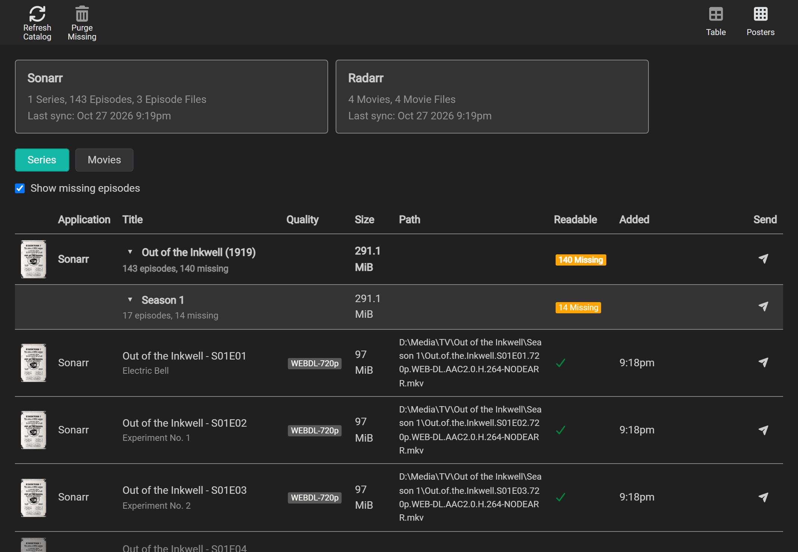
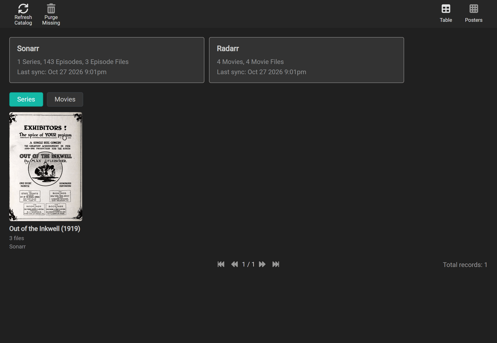

# Finding and fetching

## What your friends have

**Catalog > Peer Catalog** lists every file your friends share with you, each marked against your own library:

| Status | Meaning |
| --- | --- |
| **Missing** | The series, movie, scene or album is in one of your Arr apps, and you have no file for it. |
| **Upgrade** | You have a file, and your friend's is one your Arr app's quality profile would take in its place: better, with your copy still below the profile's cutoff and upgrades allowed. A PROPER or REPACK of the quality you have counts too, unless your Arr app's **Propers and Repacks** setting says not to upgrade to them. The quality then has a **Proper** or **Repack** label beside it. |
| **Have** | You have a file, and this offer is not an upgrade under your local quality profile. This also applies when upgrades are off or the cutoff is met. |
| **Not in library** | None of your Arr apps has it. **Get it** can add it for you. |

These words use the same colors in both catalogs, in tables, posters and details cards: green for **Have**, red for **Missing**, blue for **Upgrade**, and neutral for **Not in library**. The light theme uses darker shades of the same colors so they remain readable.

Both **Table** and **Posters** have the same kind filters: **Series**, **Movies**, **Music** when Lidarr is connected, and **Scenes** when Whisparr is connected. The selection is remembered on this page. In **Table**, a show opens into seasons, then episode files. A file with several episodes appears once under its season. Show and season rows count distinct episodes across friends, missing or upgradable episodes and total offered size; their status is **Missing** if any episode is missing, otherwise **Upgrade** if any is upgradable. The tree uses Sonarr's TVDB season and episode numbers. Anime rows show absolute numbers, scene numbers appear alongside TVDB numbers when they differ, daily shows show air dates, and specials (season 0) appear last.

Select **Posters** to switch from the file list to a grid for the selected kind. The grid groups files into one tile per title, including copies shared by different friends. Each tile shows how many files you have or are missing. Select **Table** to return to the file list.

**Show missing episodes** starts on in the peer series table and cards. It shows the episodes your app is missing that the friend shares. Turn it off to hide those **Missing** entries; **Have**, **Upgrade** and neutral **Not in library** entries remain. Episodes the friend cannot provide are never added to this list. The table and cards share this choice, and your browser remembers it separately from the local catalog.

Select a series, episode, movie, Whisparr film or scene poster or title to open its details card. For a file with several episodes, choose the episode in the card. The details are what that friend shared from their Arr app: descriptions, genres, network or studio, runtime, dates and file resolution where available. An episode card includes its series genres, network and runtime. Cards read the copy already stored on your node; opening one does not fetch more details from the friend. After updating, older cached catalogs refresh in full at the next successful sync to fill in missing details. The arrow beside a series or season expands its rows. A peer details card offers **Get it** for the title or episode it shows when something is missing or upgradable. Lidarr details cards are planned separately.

An episode has its own description and air date, and a movie has its own description, genres and runtime:

Choose **Movies** to see movie posters on their own:

Posters come from your friends' Arr apps. Nodearr caches each image for 30 days before requesting it again; it does not contact an external image service ([ADR 0022](../adr/0022-posters-from-friends-arr-apps.md)).

Filter by friend or select a status to show only matching files. To refresh all friends' offers now, select **Sync Peer Catalogs**. Scheduled refreshes run every 15 minutes by default; change **Catalog Sync Interval** under **Settings > Node** if needed.

**Home** shows how many files your friends have that you are missing or could upgrade.

## What you have

**Catalog > Local** shows what your connected Arr apps hold. In the series table and cards, **Show missing episodes** starts off, showing only downloaded episodes. Turn it on to include the missing episodes your Arr app knows about. The table and cards share this choice, and your browser remembers it separately from the peer catalog.

Local posters show the number of files you have in green. A file's **Have** status describes the library; its separate readability icon says whether Nodearr can read it to send.

## Get it from the catalog

Select **Get it** beside a file, on its details card, or use the download icon over a poster. The icon appears on hover or keyboard focus, and stays visible on touch screens. A series card or poster starts at **Whole series**; an episode card starts at its **Episode file**, and a movie card selects that movie. For TV, choose **Episode file**, **Season** or **Whole series** in the dialog. An episode file can contain several episodes; all of them are selected together. Whole series follows Sonarr's All Episodes choice and leaves specials out; choose season 0 or an episode file for those. For music, the selection is one complete album.

Nodearr fills in the root folder and quality profile most of your library uses. A new series starts with your friend's series type; you can change it. Lidarr also needs a metadata profile. If you have several apps of the right kind, choose which app to use. A title already in that app keeps its settings.

Select **Get it** in the dialog to add the title, monitor what you chose and search. Progress appears there; after the app grabs a result, follow it on **Activity > Transfers**. You can close the dialog and reopen it while the app is being asked. No send card is added to Home.

TV goes to Sonarr, movies to Radarr, music to Lidarr, and adult films and scenes to Whisparr v3. A scene known only by Whisparr v2's own ID cannot be added this way; the dialog explains how to add it in Whisparr instead. If an app does not answer or has no root folder, fix that in the app and return to the dialog. Valid choices stay selected when the plan refreshes.

Only trusted friends' current offers can be requested. **Have** has no action. **Upgrade** can be requested, and your Arr app decides whether to replace your file using its own profiles and rules. Searching uses all the app's enabled indexers, so it may choose another acceptable release.

## Try your first transfer

Both nodes must be running, and your friend must share at least one file you want.

1. In Nodearr, go to **Nodes > Trusted Nodes** and select **Check connection** for your friend. **Direct** means files can move. **Relay only** allows messages but no media transfers; if it stays that way, see [Relay only](troubleshooting.md#relay-only).
2. Open **Catalog > Peer Catalog** and select **Sync Peer Catalogs**. Find a file your friend shares. If their catalog is empty, ask them to check their app choices and **Hidden** on **Catalog > Sharing**.
3. Select **Get it** beside the file or on its card, or use the download icon over its poster, check the choices, then select **Get it** in the dialog. You can also add it in your Arr app and run an interactive search there. If the app rejects a result, read its reason; your quality profile or other rules may exclude it.
4. In Nodearr, open **Activity > Transfers** and wait for **Completed**. The file has then passed verification. Your Arr app imports it at its next download-client check, usually within a minute, then removes the completed download from Nodearr.
5. Check the title in your Arr app to confirm that the file was imported. If the transfer completed but import failed, check the app's queue and Nodearr's **System > Status** for a folder-access warning.

> [!NOTE]
> Pairing does not immediately download the friend's existing library. New app connections fetch later missing arrivals automatically by default; search for older files or use **Get it**.

## How your Arr apps find it

After you [connect an Arr app](connecting-apps.md), it searches Nodearr alongside its other indexers. Nodearr returns matching files from your friends' catalogs. The Arr app decides whether to download a result using its own quality profiles and other rules.

- Interactive searches show Nodearr's results alongside other results so you can choose one.
- Automatic searches can select a Nodearr result when it is the best acceptable match.
- New connections automatically fetch later arrivals the app monitors and is missing. Existing connections keep their previous RSS choice after upgrading.

In Nodearr, go to **Settings > Apps**, edit the app and use **Fetch new files from friends automatically** to control RSS. **Including upgrades** starts off; enable it to let the app replace existing files when its profile allows an upgrade. Select **Save**. Nodearr applies these choices at each registration sync, including with **Add Only**.

Each connected library app has its own RSS feed. It lists files that arrived in a friend's shared catalog after the initial sync and that this app is missing, plus upgrades only when **Including upgrades** is on. A file you already have at that quality, or a title outside that app's library, is left out. Pairing does not announce the friend's existing library through RSS; you can still find those files by searching.

You can exclude a friend from every app's automatic feed under **Catalog > Sharing**. See [Choosing which friends to fetch from automatically](friends-and-sharing.md#choosing-which-friends-to-fetch-from-automatically).

RSS skips friends whose last connection check found no direct route, because their files cannot be downloaded. Friends not yet checked remain eligible. A later catalog update that only changes an existing file's description does not announce it as a new arrival.

Existing indexers receive their app-specific address at the next registration sync. The legacy address used by Prowlarr and registrations not yet updated keeps its unfiltered feed. Prowlarr's copies remain disabled.

Results use the release name saved by the sender's Arr app, or a title Nodearr builds from the catalog metadata. The receiving app evaluates quality and custom formats from that title as it does for any indexer.

The same file offered by two friends is one result. A result says nothing about which friend it is from.

### What each app is shown

- [Sonarr](https://sonarr.tv/) is shown episodes, matched by the series' IDs and the season and episode it asks for. A file holding several episodes is a result only for those episodes.
- [Radarr](https://radarr.video/)'s default movie categories return movies matched by TMDb or IMDb ID and exclude [Whisparr](https://whisparr.com/)'s films.
- Whisparr is shown films and scenes, from friends' Whisparr v2 and v3. These need a search in the XXX categories.
- [Lidarr](https://lidarr.audio/) is shown albums, by artist and album. These need a search in the Audio categories.

The categories in the request decide what can be found, not which app sent it. Sonarr's and Radarr's default categories leave adult content and albums out. A manual search in [Prowlarr](https://prowlarr.com/) can find them when those categories are selected.

## What happens to a grab

When an Arr app grabs a Nodearr result, it sends the request to Nodearr's download client using the [SABnzbd](https://sabnzbd.org/) interface. In Nodearr, **Activity > Transfers** shows the download and any files you are uploading to friends.

The **Activity** badge counts unfinished downloads and active uploads, each with its own icon. Hover it for counts of downloading, sending, waiting, retrying and failed work. It updates even while you are on another page and disappears when there is nothing active or needing attention.

The badge and transfer status labels use the same colors: teal while files move, amber while waiting or retrying, green when complete, and red when failed. A failed download keeps the badge red until you select **Retry** or **Remove**. Completed downloads and finished uploads do not count. A cut or failed upload stays in the **Sending** history but does not keep the badge red: the receiving node owns retrying or removing that download.

- **Queued**: waiting its turn. Three downloads run at once unless **Most Downloads at Once** on **Settings > Node** says otherwise, and the rest start in the order your Arr apps asked for them. Your Arr app's queue shows it as queued too.
- **Downloading**: arriving from your friend, with its progress. Your Arr app's queue shows the same.
- **Waiting**: your friend's node is already sending as many files as its **Most Uploads at Once** allows, and has put this one in line. The row says which friend and your place in line. It starts when your turn comes, and your Arr app's queue shows it as queued meanwhile.
- **Completed**: it arrived, matched the hash your friend's node gave before sending, and was moved into place in one step. Your Arr app imports it at its next check, usually within a minute, and then asks Nodearr to remove it.
- **Failed**: the transfer stopped without a verified file. **Activity > Transfers** and the Arr app's history show the reason. See [When a transfer fails](#when-a-transfer-fails).

The uploads list below shows what you are sending. When friends ask for more files than your own **Most Uploads at Once** allows, the extra requests wait their turn there as **Waiting**, with their place in line, instead of being refused. A friend running a Nodearr version from before this setting waits its turn too, but cannot be told: its download looks like one still connecting until its turn comes.

Nodearr writes incoming files under `incomplete` in its download folder. After verification, it moves them into `complete` for the Arr app to import. An album becomes available for import only after every track has arrived and passed verification.

If Nodearr restarts, it resumes unfinished transfers. If the sender goes offline, Nodearr retries while attempts remain. Once the attempts are exhausted, wait for the friend to return, then search again in your Arr app or select **Retry** in Nodearr.

A retry resumes from the downloaded portion if the file has not changed. Nodearr can switch to another friend offering an identical file, identified by its hash and size. Album transfers stay with their original sender.

## When a transfer fails

A transfer gets up to three attempts per source, with 15 seconds between retries. Each track in an album has its own three attempts. If the transfer fails after those attempts, Nodearr reports the failure to the Arr app, which records the reason, blocklists the result and searches again.

| Reason | What it means | What to do |
| --- | --- | --- |
| `NoDirectRoute` | The two nodes could only reach each other through a relay, and files never go that way. | See [Relay only](troubleshooting.md#relay-only). |
| `DirectPathLost` | The direct connection was lost during the transfer. | Let Nodearr retry. If failures continue, see [Relay only](troubleshooting.md#relay-only). |
| `ConnectionLost` | The connection to the other node was lost. | Let Nodearr retry. If attempts are exhausted, check that the friend is online before trying again. |
| `PeerUnreachable` | The other node could not be reached. It may be offline. | Wait until it is back, then search again. |
| `NotAuthorized` | The other node no longer shares this file with you. | Nothing: they chose to stop. |
| `Revoked` | Trust between the two nodes has ended. | Pair again, if you both want to. |
| `Blocked` | The other node has blocked yours. | Transfers cannot resume unless they unblock your node and you pair again. |
| `NotFound` | The other node no longer has the file, or cannot read it. | They may need a [path mapping](connecting-apps.md#when-nodearr-sees-the-library-at-another-path). |
| `VerificationFailed` | The downloaded file did not match its expected hash. Nodearr discards it and retries from the start. | Let Nodearr retry with a newly calculated hash. If failures continue, ask the sender to check the source file. |
| `DiskError` | The file could not be written here. | Check the download folder has room and can be written to. **System > Status** says if it cannot. |

On **Activity > Transfers**, select **Retry** to create a new attempt for a failed transfer. **Remove** deletes the transfer and its downloaded files, including any partial download.
