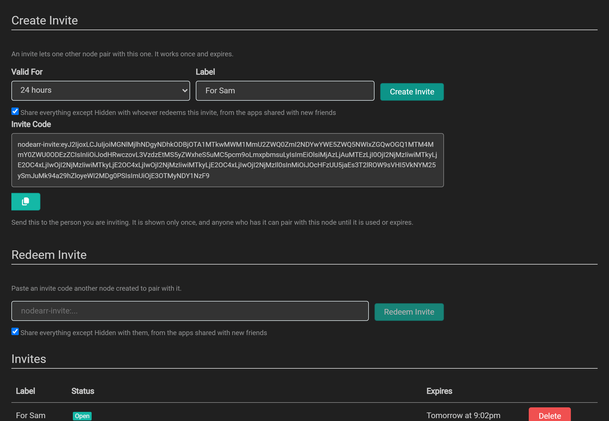
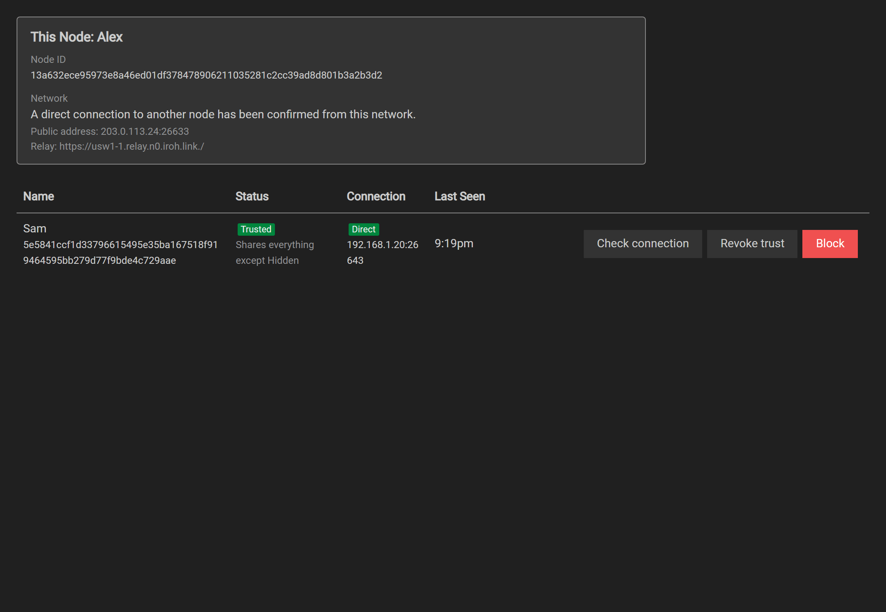
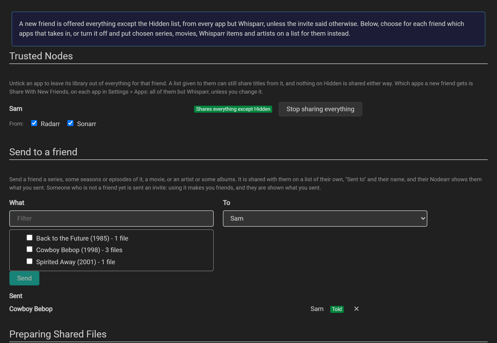
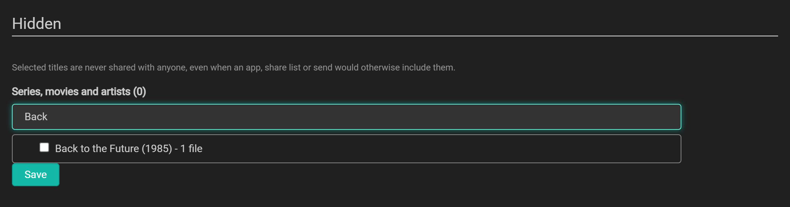
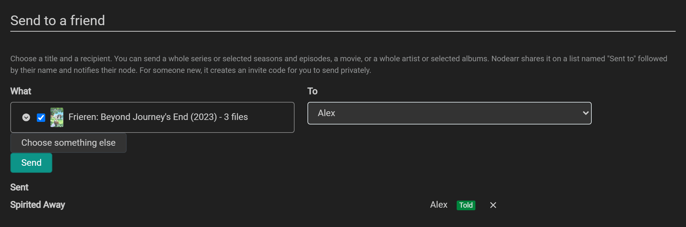
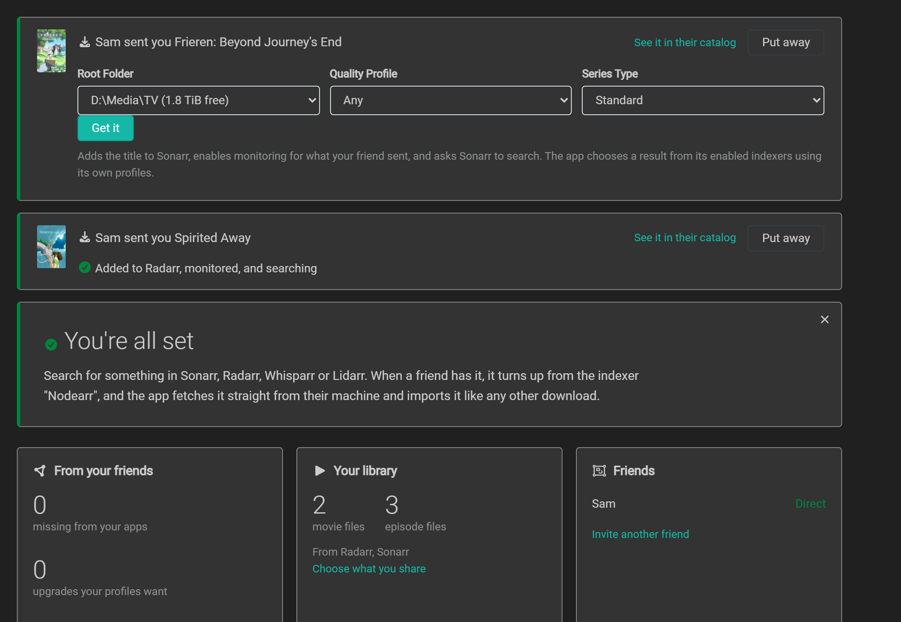
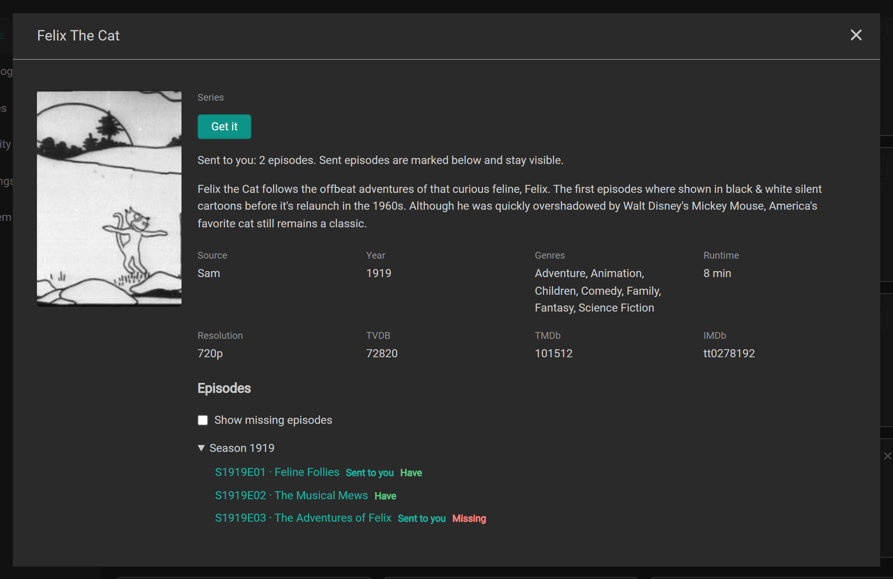
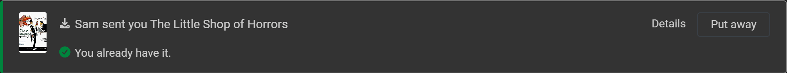
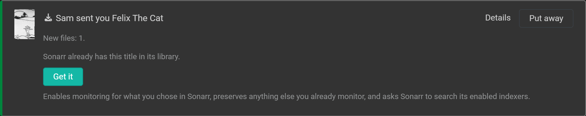

# Friends and sharing

Two Nodearr instances become trusted friends when one redeems the other's invite. Each person chooses what to share. Your friend's sharing choices do not change yours.

## Inviting a friend

Keep your node running and online while your friend redeems the invite. In Nodearr, go to **Nodes > Invites**.

See an invite ready to send

1. Set **Valid For** to the invite's lifetime. The default is 24 hours. Enter a **Label** to remind yourself who it is for.
2. Choose what to share. The sharing checkbox, **Share everything except Hidden with whoever redeems this invite, from the apps shared with new friends**, is selected by default. It includes existing and future files from apps with **Share With New Friends** enabled. That setting starts on for [Sonarr](https://sonarr.tv/), [Radarr](https://radarr.video/) and [Lidarr](https://lidarr.audio/), and off for both [Whisparr](https://whisparr.com/) versions. Clear the checkbox to share only lists you assign to this friend.
3. Select **Create Invite** and copy the code. Send it privately to your friend.

When your friend redeems the code, both nodes appear as **Trusted** on **Nodes > Trusted Nodes**.

An invite can be used once by one node, before it expires. **Nodes > Invites** shows whether an invite is open, used or expired.

The code contains your node's ID, network addresses, expiry time and a secret. Anyone who obtains an unused code can pair with your node, so send it only to its intended recipient. Your node stores a hash of the secret rather than the secret itself.

## Using a friend's invite

1. In Nodearr, go to **Nodes > Invites** and paste the code under **Redeem Invite**.
2. Choose what you will share with this friend. The checkbox **Share everything except Hidden with them, from the apps shared with new friends** includes apps with **Share With New Friends** enabled; both Whisparr versions are excluded by default. Clear the checkbox to share only lists.
3. Select **Redeem Invite**.

Your node connects to your friend's node and redeems the invite. After pairing succeeds, both nodes appear as **Trusted** on **Nodes > Trusted Nodes**, under the names you each chose.

If it fails:

- **"This invite has expired"** or **"did not accept this invite"**: it ran out, or it was used already. Ask for a new one.
- **"Unable to reach the node that created this invite"**: your node could not get through to your friend's. Both nodes need to be running and online. See [Troubleshooting](troubleshooting.md#a-friend-cannot-be-reached).
- **"turned away too many invites from this node lately"**: your node tried five codes in 15 minutes that did not work. Wait 15 minutes, then try once with a fresh code.

## Your friends

**Nodes > Trusted Nodes** lists the nodes you have paired with. For each node, it shows:

- **Status**: **Pending**, **Trusted**, **Revoked** or **Blocked**. A pending node has not completed pairing.
- **Connection**: **Direct** allows file transfers. **Relay only** allows pairing and connection checks, but the friend's library cannot be browsed and no media moves; see [Relay only](troubleshooting.md#relay-only).
- A summary of what you share with that friend.
- **Last seen**, the most recent contact with that node.

What you can do depends on where trust stands:

| Status | What you can do |
| --- | --- |
| Trusted | **Check connection** (does it again now, and says whether files can move), **Revoke trust**, **Block** |
| Pending, Revoked | **Block**, **Delete** |
| Blocked | **Unblock** |

- **Revoke trust** ends trust here, stops transfers with that friend and clears their catalog from your node. Nodearr tries to tell them, so their node does the same. If they are offline, their page may still show you as trusted, but your node refuses their requests. To be friends again, one of you sends a new invite.
- **Block** ends trust here and turns that node away whenever it connects, before it reaches Nodearr. It stops transfers and clears their catalog here, without telling them. They cannot pair with you again, even with a new invite, until you unblock them. Unblocking does not restore trust: it takes a new invite.
- **Delete** forgets a node that is not trusted. A blocked node cannot be deleted, so it stays blocked.

## Choosing which friends to fetch from automatically

On **Catalog > Sharing**, each trusted friend has **Fetch new files from this friend automatically**, selected by default. Clear it to leave that friend's new files out of every app's automatic-fetch feed. Select it again to include eligible arrivals. The change is saved immediately and applies to all your library apps.

Each app also needs **Fetch new files from friends automatically** enabled under **Settings > Apps**. An app can only fetch an upgrade automatically if **Including upgrades** is enabled there. See [Finding and fetching](finding-and-fetching.md#how-your-arr-apps-find-it).

This choice does not change what you share with the friend. You can still browse their catalog, use **Get it**, and find their files in an Arr app's manual searches. If a transfer from another friend needs to resume and this friend has an identical copy, Nodearr can use that copy even when automatic fetching from this friend is off.

## Choosing what to share

By default, a new friend can access files from apps with **Share With New Friends** enabled, except titles on **Hidden**. Both Whisparr versions start with this setting off; other library apps start with it on. You can choose to share only lists when creating or redeeming an invite.

To change an existing friend's access, go to **Catalog > Sharing**.

### With a friend: everything, some apps, or lists

Under **Trusted Nodes** on the Sharing page, each friend has a line of their own:

- Select **Share everything except Hidden** to share the libraries of selected apps. Select **Stop sharing everything** to share only assigned lists.
- When library sharing is on, select the apps to include. Clearing an app's checkbox excludes its library from this mode of sharing.
- Assigned lists can share titles from any app, including an app excluded from library sharing. For example, exclude Whisparr's library, then assign a list containing only the Whisparr titles you want this friend to see.

**Hidden** overrides both app selection and lists. A hidden title is never shared.

The summary beside each friend describes their access. You can also see that summary on **Nodes > Trusted Nodes**.

To set the default for future friends, edit the app under **Settings > Apps** and change **Share With New Friends**. This also controls what happens when you add an app: if enabled, its library is included for existing friends who receive everything except **Hidden**. If disabled, select it individually for any existing friend who should receive it.

### Lists

A share list gives selected friends access to selected titles. On **Catalog > Sharing**:

1. Enter a name under **New List**, then select **New List**.
2. Select the titles to include. You can select a whole series, individual seasons or episodes; a whole artist or individual albums; or whole movies and Whisparr titles.
3. Under **Shared with**, select the friends who should receive the list.
4. Select **Save**.

Selecting a whole series includes future seasons and episodes. Selecting a season includes future episodes of that season, but no other seasons. Selecting a whole artist includes future albums; selecting individual albums does not.

An album is shared only when Lidarr has every track. **Catalog > Sharing** shows which tracks are still missing.

A file containing several episodes is shared only if you share every episode it contains.

### Hidden

Use **Hidden** for titles you do not want to share with anyone. It overrides app selection, share lists and sends. You can hide a whole title or selected parts, such as one season or one album.

There is one **Hidden** list on **Catalog > Sharing**:

1. Find the title with **Filter**.
2. Select the title, seasons, episodes or albums to hide.
3. Select **Save**.

Nodearr stops sending those files immediately and asks affected friends to refresh your catalog. An offline friend's catalog may still show the files until the next successful sync, but requests for them are refused.

To make a title available again, clear its checkbox and select **Save**. Your other sharing choices then determine who can access it. The **Hidden** list has no **Shared with** selector and cannot be deleted.

A whole series or artist that is hidden stays hidden as it grows: a new episode or album of it is never offered. Your Arr apps are not told anything: **Hidden** is only about what your friends see.

### When sharing changes

- **Removing access stops uploads immediately.** When you unshare or hide something, or Nodearr learns that your Arr app deleted it, your node stops sending it and tells each friend who was offered it to fetch your catalog again. It usually leaves their catalog within seconds. If the hint cannot reach them, they find out at their next sync. An old offer never lets them fetch a file that is no longer shared.
- **Newly shared titles wait for a catalog refresh.** Each friend's node picks it up at its next catalog sync, every 15 minutes unless they changed it (**Settings > Node**), or straight away if they select **Sync Peer Catalogs** on **Catalog > Peer Catalog**.

Nodearr checks your current sharing choices on every file request. A cached offer does not preserve access to an unshared file.

## Sending something to a friend

Sending a title shares it with one person and places a card on their **Home** page. The recipient chooses whether to download it. You can start in either place:

- In **Catalog > Local**, use **Send** at the end of a table row. A file row selects its movie, episode or episodes in a multi-episode file, or album; a series row selects the whole series, and a season row selects that season. In **Posters**, use the send icon under a tile to select the whole title.
- In **Catalog > Sharing**, find **Send to a friend**:

The Local action opens the form with the title and parts already selected. In Sharing, select a title and, for a series or artist, the seasons, episodes, or albums you want to send. Choose a friend under **To**. To send to someone you have not paired with, select **Someone new, with an invite** and choose an invite lifetime. For someone new, decide whether to leave **Share everything except Hidden with them too** selected. Clear it to share only this send. If selected, it also includes apps with **Share With New Friends** enabled, excluding **Hidden**. Select **Send**.

Nodearr creates a share list named **Sent to** followed by the friend's name. You can edit it like any other list. Nodearr also notifies the recipient, whose node refreshes your catalog and shows a card such as **Sam sent you Felix The Cat - S1919E01** on **Home**.

If nothing of it can be sent, Nodearr says so: there is no file of it in your library yet, or it is on your **Hidden** list.

For someone new, Nodearr shows an invite code. Send it privately to the recipient. Once they redeem it, you become friends and the card appears on their **Home** page. The invite is also listed on **Nodes > Invites**, with a label beginning **For** followed by the title.

The **Sent** list under the form says how each send stands:

- **Told**: their Nodearr knows.
- **Shared, not told yet**: it is shared with them. Nodearr tries to tell them at each connection check, every 15 minutes, for up to 30 days. An older Nodearr that cannot take the note still finds what you sent in its catalog.
- **Invite not used yet**, or **Invite expired or deleted**.

Removing a send from **Sent** removes the notification record, but its share list remains. Edit or delete the list to stop sharing those titles. Removing a send also deletes its invite if the invite has not been used.

## When a friend sends you something

When a friend sends you a title, a card such as **Sam sent you Felix The Cat - S1919E01** appears on **Home**.

Select **Details** or the small poster to read about the title in a card over Home. Closing it returns to the same place on Home. A whole-series send opens the series card; a single episode opens that episode. For selected seasons or several episodes, the series card marks the sent episodes **Sent to you**. Those episodes stay visible even when **Show missing episodes** is off.

The details card has the same **Get it** choices as the peer catalog. Home keeps its own **Get it** as the quick path for exactly what was sent. Music sends open artist or album cards too. A partial artist send marks the albums that were sent; songs are informational. Home's **Get it** keeps the exact sent selection.

If you have every file your friend sent and their copies are not upgrades, Home says **You already have it.** and offers no **Get it**. You can still read the details or select **Put away**. The notification leaves Home 24 hours after it first appears on screen in an active Home tab. An unseen notification stays until you see it; revisiting Home does not restart the day.

If you have only some files, **New files** counts the sent files you are missing. **Upgrades** counts files that are better under your app's quality rules, including PROPER and REPACK when the app allows them. These cards keep **Get it**. Counts describe files, so one file covering several episodes counts once. They appear after the sender's complete offer is available; a withdrawn or incomplete offer is not treated as already held.

If your library changes and a previously held send now contains missing files or upgrades, the card keeps **Get it** and its previous display time is cleared. Your friend's send still says **Told**; it does not report whether you already had the files.

To request the title:

1. Choose an **App** if you have more than one of the required type, such as separate Sonarr instances for HD and 4K.
2. For a new title, review **Root Folder** and **Quality Profile**. Nodearr initially chooses the values used most often in that app. A series also has **Series Type**, taken from your friend's Sonarr; Lidarr also requires **Metadata Profile**.
3. Select **Get it**. Nodearr adds a new title to the app, enables monitoring for what was sent and asks the app to search. For an existing title, it preserves anything else you already monitor.

A whole series includes future episodes but excludes specials. To include specials, the sender must select Season 0 or its episodes.

For Sonarr, the initial search targets missing episodes offered by the sender. For a whole artist in Lidarr, it targets the offered albums. If Nodearr has no matching files from that friend in its catalog yet, it searches the requested parts instead.

The Arr app searches all its enabled indexers and chooses a result using its own profiles. It may choose a source other than the sender. Downloads through Nodearr appear on **Activity > Transfers**, then the Arr app imports them.

A series goes to Sonarr, a movie to Radarr, music to Lidarr, and a film or scene to Whisparr v3.

The card reports what happened or explains a failure and lets you retry. If you add or remove root folders or profiles in the Arr app, the card updates its choices when it checks the app again. Choices you made are kept while the app still offers them.

After **Get it** succeeds, the card stays until Nodearr's local catalog shows you have the files that were sent, or until 24 hours after that success, whichever comes first. Home checks while it is open and when you reload it. A failed card stays until you retry or select **Put away**, unless the files become held, when it follows the already-held notification rules above.

**Get it** cannot add titles to Whisparr v2, or add a scene originating in a friend's Whisparr v2 to Whisparr v3. Add those titles in Whisparr yourself, then search there to find your friend's copy.

If the friend's catalog has not arrived, or the friend no longer shares the sent files, Home explains that details are unavailable. Opening details checks the sender's current cached offer, without contacting their Arr app. Ending trust removes that friend's received cards. Select **Put away** to dismiss a card yourself.

### Hashing

Nodearr calculates hashes for shared files in the background so a transfer can start without first reading the entire source file. **Catalog > Sharing** shows progress. Background hashing pauses during uploads and runs again for a file only when it changes.

The hash also identifies identical copies offered by different friends. A download can resume from another friend with the same file if its original sender becomes unavailable.
