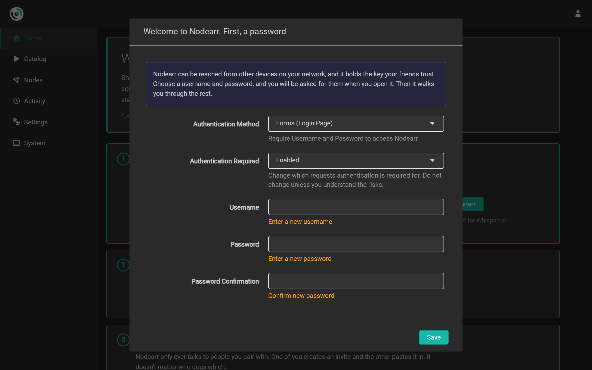
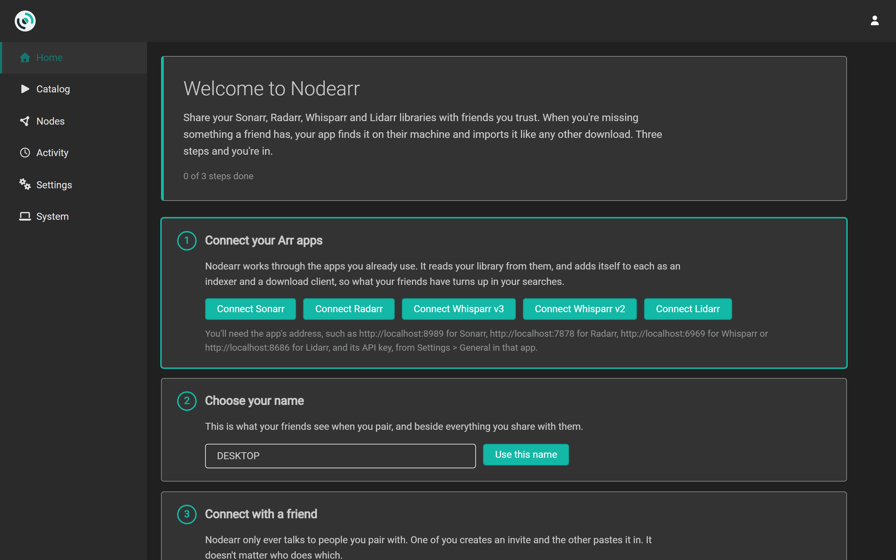

# Installing

Nodearr runs in [Docker](https://docs.docker.com/) or directly on Windows, Linux and macOS. Choose a setup that lets Nodearr read your Arr libraries and lets the Arr apps read Nodearr's download folder. Running it alongside your existing Arr apps usually makes this easier.

Download Nodearr from the [Releases](https://github.com/Nodearr/Nodearr/releases) page. Before running a package, compare its SHA-256 hash with the matching entry in the release's `SHA256SUMS` file.

## Docker

The image is `ghcr.io/nodearr/nodearr`, for amd64 and arm64. The [example compose file](../../docker/docker-compose.yml) puts it beside [Sonarr](https://sonarr.tv/) and [Radarr](https://radarr.video/). Copy it and change the paths.

Check these three parts of the setup:

1. **`/downloads` is one folder**, mounted at the same path in Nodearr and in every Arr app. Nodearr puts a finished transfer there, and the Arr app imports it from there. If the Arr app sees it at another path, it cannot import, and **System > Status** says so.
2. **Libraries are mounted read-only into Nodearr at the same paths the Arr apps use**, such as `/tv:ro` and `/movies:ro`. Nodearr only ever reads them, to send files to friends you share them with. If the paths differ, add a path mapping (see [Connecting your apps](connecting-apps.md#when-nodearr-sees-the-library-at-another-path)).
3. **The networking.** Friends' nodes reach yours over UDP:
   - On Linux, use the host's network (`network_mode: host`). It gives the best chance of a direct connection, and it is the only way Nodearr can ask your router to open the port itself.
   - On Docker Desktop (Windows or macOS), or if you prefer a bridge network, publish `6633/tcp` and `6633/udp`, and forward UDP 6633 on your router to the machine. Docker Desktop gives a container a different public port for every destination, and without the forward, friends often cannot connect directly.

`/config` holds the database, the settings and the node's key. Keep it, and back it up: a node that loses its key is a new node that none of its friends trust.

Set `PUID` and `PGID` to the user your Arr apps run as, so the files Nodearr writes can be imported and deleted by them.

The image sets the web port to 6633, the bind address to all interfaces, the UDP port to 6633 and the download folder to `/downloads`. These settings appear as controlled by the environment in the UI. Override the corresponding environment variables in your Compose file if needed. For example, use `Nodearr__Server__Port` to change the web port with host networking. See [environment overrides](settings.md#set-by-the-environment).

## Windows

Run `Nodearr.<version>.win-x64-installer.exe`. It installs into Program Files and asks how Nodearr should start:

- **When you sign in, in the tray** (the default). It runs as you, so it can read whatever your account can.
- **When the computer starts, as a Windows service.** It runs whether anyone is signed in, as the `LocalService` account. That account may not be able to read your library or a network share. If **System > Status** reports unreadable files, open Windows **Services**, find **Nodearr**, open **Properties** and select **Log On**. Choose an account with access to the library.
- **Not automatically.** Start it from the Start menu.

The installer adds two Windows Firewall rules: one letting UDP in to `nodearr-transport.exe`, which is how friends' nodes reach yours, and one opening the web port, 6633, so Arr apps on other machines or in Docker can reach Nodearr. Uninstalling removes both.

The data folder is `C:\ProgramData\Nodearr`, whichever way it starts. Installing over an older version, or uninstalling, leaves it alone.

There is also a zip, `Nodearr.<version>.win-x64.zip`. Unpack it anywhere and run `Nodearr.exe` for the tray, or `Nodearr.Console.exe` in a terminal. `ServiceInstall.exe` and `ServiceUninstall.exe`, run as administrator, add and remove the service and the firewall rules, as the installer does. Windows may ask about the firewall the first time Nodearr runs from the zip. Allow it, or friends cannot connect.

32-bit builds (`win-x86`) are there for older machines.

## Linux

Unpack the archive for your machine:

| Archive | For |
| --- | --- |
| `linux-x64` | x86-64 with glibc: Debian, Ubuntu, Fedora and most others |
| `linux-arm64` | 64-bit ARM with glibc, such as Raspberry Pi OS 64-bit |
| `linux-arm` | 32-bit ARM with glibc |
| `linux-musl-x64`, `linux-musl-arm64` | Alpine |

The archive includes [.NET](https://dotnet.microsoft.com/), but the system still needs its [native Linux dependencies](https://learn.microsoft.com/en-us/dotnet/core/install/linux-scripted-manual#dependencies), including ICU and OpenSSL. ICU is `libicu72` on Debian bookworm and `icu-libs` on Alpine; check the package name for your distribution and version. For the `linux-x64` package:

```sh
tar -xzf Nodearr.<version>.linux-x64.tar.gz
```

```sh
./Nodearr/Nodearr -nobrowser
```

The data folder is `~/.config/Nodearr` for the user running Nodearr. If `XDG_CONFIG_HOME` is set, the default is `$XDG_CONFIG_HOME/Nodearr`. Use `-data=<folder>` to choose another location.

To start it with the machine, run it as a service under the same user as your Arr apps. The following systemd unit is an untested example based on Sonarr's. Replace `media` with an existing user and group, put the application in `/opt/Nodearr`, and make `/var/lib/nodearr` writable by that user before using it:

```ini
[Unit]
Description=Nodearr
After=network-online.target

[Service]
User=media
Group=media
Type=simple
ExecStart=/opt/Nodearr/Nodearr -nobrowser -data=/var/lib/nodearr
TimeoutStopSec=20
KillMode=process
Restart=on-failure

[Install]
WantedBy=multi-user.target
```

Open UDP for `nodearr-transport` in any firewall on the machine, such as `ufw`, or friends cannot connect directly.

## macOS

Unpack `osx-arm64` (Apple silicon) or `osx-x64` (Intel). macOS marks a downloaded archive as quarantined; clear it before the first start, as with Sonarr:

```sh
xattr -dr com.apple.quarantine Nodearr
```

```sh
./Nodearr/Nodearr
```

The data folder is `~/Library/Application Support/Nodearr`, or wherever `-data=` points. The macOS packages are built by the release workflow but have not yet been run on a Mac.

## The first start

Open `http://localhost:6633`, or the machine's address and port 6633 from another one.

1. Choose a username and password when prompted, then select **Save**. Nodearr is reachable from your network and stores your identity key and Arr API keys, so keep sign-in enabled. You can change authentication settings later under **Settings > General**.

   

2. On **Home**, complete the three setup steps:
   1. [Connect your Arr apps](connecting-apps.md).
   2. Choose the name your friends will see.
   3. [Connect with a friend](friends-and-sharing.md): create an invite, or paste one.

   

Once setup is complete, **Home** shows warnings, titles sent by friends, files you are missing, your library and your connections.

## Updating

Nodearr does not update itself. [Create a backup](backups.md#when-they-are-made) before updating. Install the new version over the old one, or pull the new Docker image and recreate the container using the same `/config` volume. Keep the existing data folder to preserve settings, friends and the identity key.
