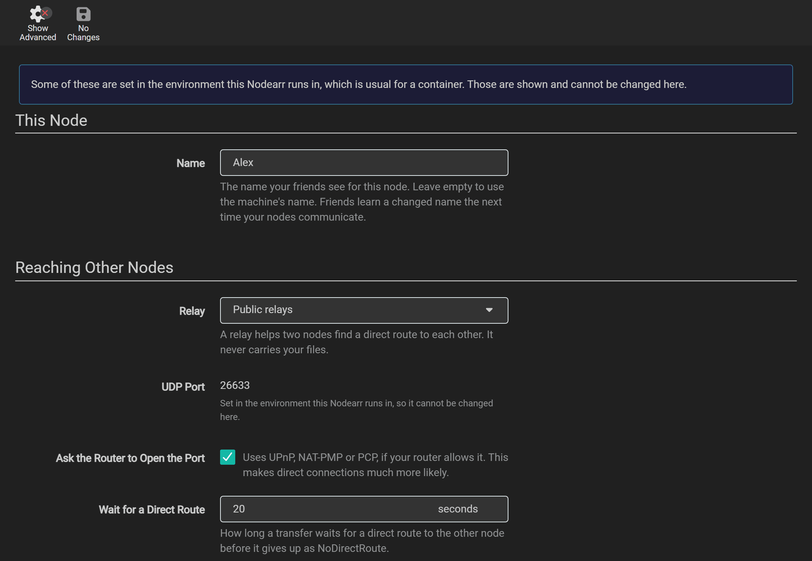
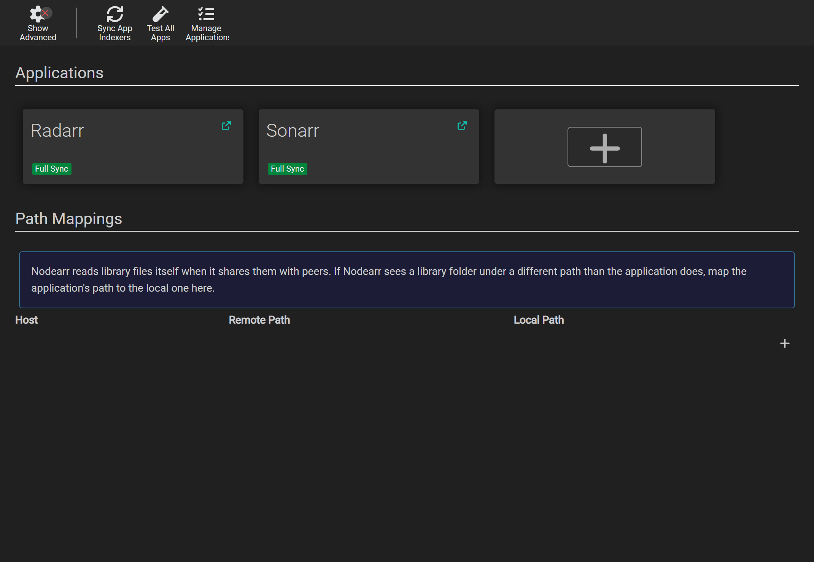

# Settings

Use **Settings > Node** for peer connections and transfers, **Settings > General** for the web UI and sign-in, and **Settings > Apps** for Arr connections. The tables below list defaults and environment overrides.

## Settings > Node

These settings control your node's name, peer connections and download storage ([ADR 0019](../adr/0019-node-settings-saved-in-the-ui-fixed-by-the-environment.md)).

| Setting | Default | What it does | Takes effect | Environment variable |
| --- | --- | --- | --- | --- |
| **Name** | The machine's name | The name shown to friends. They receive a changed name the next time the nodes communicate. | Immediately in this UI | `Nodearr__Transport__NodeName` |
| **Relay** | **Public relays** | **Public relays**: n0's, which help two nodes find each other and never carry downloaded media. **A relay of your own**: one you run, entered in **Relay Address**, with the same direct-only rule for media. **No relay**: nodes behind home routers then usually cannot find each other. Use it only when both have addresses the other can reach. | The transport restarts | `Nodearr__Transport__Relay`: `n0`, `custom` or `disabled` |
| **Relay Address** | | The address of your own relay. Nodearr asks it before saving a new one, and refuses an address where no relay answers. | The transport restarts | `Nodearr__Transport__RelayUrl` |
| **UDP Port** | 0 | The port friends' nodes connect to. 0 lets the system pick one each time. Set one when you need to forward or allow it. | The transport restarts | `Nodearr__Transport__Port` |
| **Ask the Router to Open the Port** | On | Asks the router to open the UDP port (UPnP, NAT-PMP or PCP). | The transport restarts | `Nodearr__Transport__DisablePortMapping=true` turns it off |
| **Wait for a Direct Route** | 20 seconds | How long a transfer waits for a direct connection before it fails with `NoDirectRoute`. | The transport restarts | `Nodearr__Transport__DirectTimeoutSeconds` |
| **Download Folder** | `downloads` in the data folder | Where transfers are written: `incomplete` while they arrive, `complete` once checked. Your Arr apps must see this same folder. It cannot be moved while transfers are under way. | At once | `Nodearr__Transport__DownloadFolder` |
| **Upload Limit** | None | The most each upload to a friend may send, in kilobytes per second. 0 is no limit. | The transport restarts | `Nodearr__Transport__UploadLimitKbps` |
| **Total Upload Limit** | None | The most all uploads to friends may send together, in kilobytes per second, shared evenly between the uploads running at once. Each upload still keeps to **Upload Limit**. 0 is no limit. | The transport restarts | `Nodearr__Transport__TotalUploadLimitKbps` |
| **Download Limit** | None | The most each download from a friend may take, in kilobytes per second. 0 is no limit. | The transport restarts | `Nodearr__Transport__DownloadLimitKbps` |
| **Catalog Sync Interval** | 15 minutes | Minutes between scheduled catalog refreshes: 10 to 120. Set 0 to disable scheduled refreshes. Pairing, sends, removal notices and **Sync Peer Catalogs** can still trigger a refresh. | At once | |

When the transport restarts, connections drop for a moment and transfers carry on once it is back. If the new settings stop it starting, the page says so; change them back.

The page also shows your node ID: the public key derived from `node.key`. Changing the node name does not change this ID. Keep the key when [moving or restoring a node](backups.md).

## Settings > General

These settings control the web server, sign-in, logging and scheduled backups.

### Host

| Setting | Default | Environment variable |
| --- | --- | --- |
| **Bind Address** | `*`, every address | `Nodearr__Server__BindAddress` |
| **Port Number** | 6633 | `Nodearr__Server__Port` |
| **URL Base** | | `Nodearr__Server__UrlBase` |
| **Instance Name** | Nodearr | `Nodearr__App__InstanceName` |
| **Application URL** | | |
| **Enable SSL**, **SSL Port**, **SSL Cert Path**, **SSL Key Path**, **SSL Cert Password** | Off, 9898 | `Nodearr__Server__EnableSsl`, `Nodearr__Server__SslPort`, `Nodearr__Server__SslCertPath`, `Nodearr__Server__SslKeyPath`, `Nodearr__Server__SslCertPassword` |
| **Open browser on start** | Yes | `Nodearr__App__LaunchBrowser` |

A new port, bind address or URL base takes effect after a restart. If you change the port or the URL base, change **Nodearr Server** for each app under **Settings > Apps** too, so each one is told where to reach Nodearr now.

### Security

| Setting | Default | Environment variable |
| --- | --- | --- |
| **Authentication** | **Forms (Login Page)**, set up on the first start | `Nodearr__Auth__Method`: `Forms`, `External` or `None` |
| **Authentication Required** | **Enabled** | `Nodearr__Auth__Required`: `Enabled`, `DisabledForLocalAddresses` or `DisabledForLocalhost` |
| **Username**, **Password** | | |
| **API Key** | Made on the first start | `Nodearr__Auth__ApiKey` |
| **Certificate Validation** | **Enabled** | |
| **Trusted Networks** | Empty | `Nodearr__Server__TrustedNetworks` |

- **Forms (Login Page)** is a sign-in page and the choice offered in the UI. The inherited `Basic` configuration value is migrated to `Forms`. The configuration values `External` and `None` disable Nodearr's sign-in page and can be set in `config.xml` or the environment. Use `External` only when a reverse proxy or another service authenticates requests before they reach Nodearr.
- **Disabled for Local Addresses** lets anyone on your home network in without signing in, and **Disabled for Localhost** only someone on the same machine. Your friends' nodes never use the web UI or the API: they talk to the transport, which only trusts nodes you paired with.
- In Docker on the default bridge network, every connection to the published port looks as if it came from the bridge, a local address. So **Disabled for Local Addresses** lets in anything that can reach that port, from outside your network too if the port is open to it.
- **Trusted Networks** lists the reverse proxies whose `X-Forwarded-For` header Nodearr believes, so that it sees the address of the person behind the proxy. Nodearr always believes a proxy on the same machine. Leave it empty unless a reverse proxy runs on another address, such as another container: then add that address, or its network in CIDR notation, such as `172.17.0.1` or `10.0.0.0/8`. Add only a proxy that sets the header itself, since anything on a trusted network can claim to be any address. Takes effect after a restart.
- The **API Key** is what your Arr apps and [Prowlarr](https://prowlarr.com/) use to reach Nodearr. Resetting it gives the new one to every app set to **Full Sync**. Change it by hand in any other.

### Logging

| Setting | Default | Environment variable |
| --- | --- | --- |
| **Log Level** | **Debug** | `Nodearr__Log__Level`: `Info`, `Debug` or `Trace` |
| **Log Size Limit** | 1 MB, at most 10 | `Nodearr__Log__SizeLimit` |

Additional logging settings are available only through environment variables: `Nodearr__Log__Rotate` (number of retained log files, 50 by default), `Nodearr__Log__ConsoleLevel`, `Nodearr__Log__ConsoleFormat` (`Standard` or `Clef`), `Nodearr__Log__SyslogServer`, `Nodearr__Log__SyslogPort`, `Nodearr__Log__SyslogLevel`, `Nodearr__Log__DbEnabled` and `Nodearr__Log__Sql`.

### Backups

| Setting | Default |
| --- | --- |
| **Folder** | `Backups` in the data folder |
| **Interval** | 7 days |
| **Retention** | 28 days |

See [Backups](backups.md).

## Settings > Apps

Add and edit connections to your Arr apps and Prowlarr here. **Path Mappings** translates library paths reported by an app into paths Nodearr can read. See [Connecting your apps](connecting-apps.md) for the fields, defaults and folder setup.

## Set by the environment

Environment variables override saved settings. Use the complete variable names in the tables, such as `Nodearr__Server__Port`. A setting controlled by the environment is shown as fixed in the UI; change it in the environment and restart Nodearr instead.

The [Docker](https://docs.docker.com/) image supplies these defaults to match its ports and mounts:

| In the image | Value |
| --- | --- |
| `Nodearr__Server__Port` | 6633 |
| `Nodearr__Server__BindAddress` | `*` |
| `Nodearr__Transport__Port` | 6633 |
| `Nodearr__Transport__DownloadFolder` | `/downloads` |

Set `Nodearr__Transport__BinaryPath` to the transport executable's path if `nodearr-transport` is not beside the Nodearr executable.

In Docker, `PUID` and `PGID` set the user and group Nodearr runs as, and `TZ` sets the time zone. Match the user and group to the permissions on your library and download folders.

### Postgres

Nodearr inherits [PostgreSQL](https://www.postgresql.org/) support from [Sonarr](https://sonarr.tv/), but it has only been tested with SQLite, the default. The PostgreSQL variables are `Nodearr__Postgres__Host`, `Nodearr__Postgres__Port`, `Nodearr__Postgres__User`, `Nodearr__Postgres__Password`, `Nodearr__Postgres__MainDb` and `Nodearr__Postgres__LogDb`.

If you use PostgreSQL, back up and restore that database separately. Nodearr's [backup ZIP](backups.md#postgresql) does not include it.

## On the command line

| Option | What it does |
| --- | --- |
| `-data=<folder>` | Where `config.xml`, `nodearr.db`, `node.key`, the logs and the backups are kept. The default is `C:\ProgramData\Nodearr` on Windows, `~/.config/Nodearr` on Linux (`$XDG_CONFIG_HOME/Nodearr` when set), and `~/Library/Application Support/Nodearr` on macOS. |
| `-nobrowser` | Does not open a browser on start. |

## In config.xml

`config.xml` in the data folder holds the web listener, authentication mode, API key and logging settings. Edit it only while Nodearr is stopped. The username and password, **Application URL**, **Certificate Validation**, backup settings, node settings and Arr connections are kept in the database.
