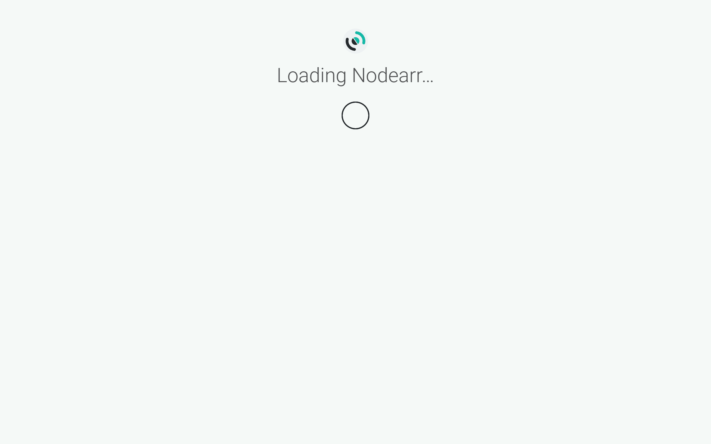
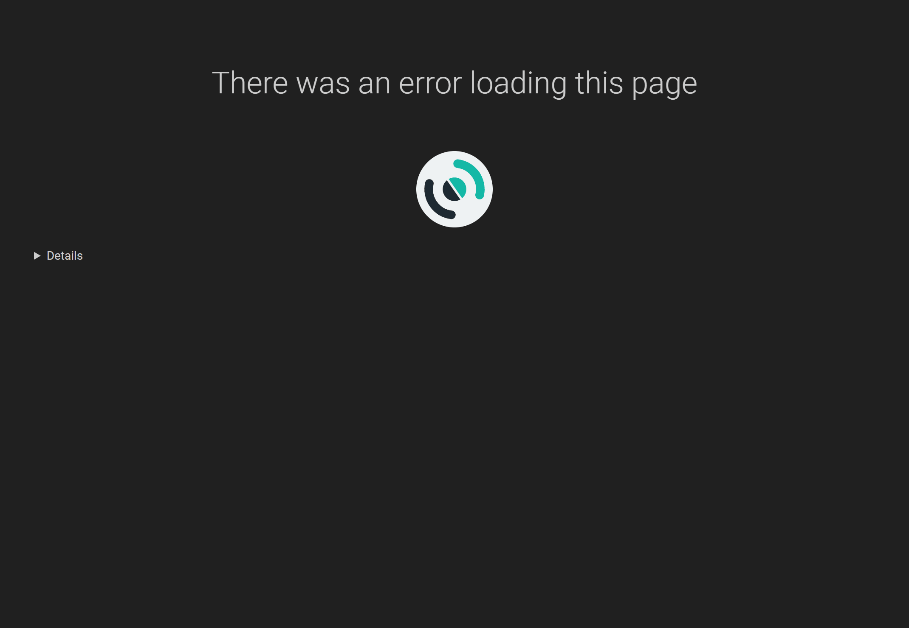

# Troubleshooting

Start with **System > Status** for health warnings. **Home** also summarizes problems that need attention. For details, open **System > Log Files**, or read the files in `logs` under Nodearr's data folder.

## Relay only

**Nodes > Trusted Nodes** shows a friend's connection as **Relay only**, or a transfer fails with `NoDirectRoute` or keeps failing with `DirectPathLost`.

The two nodes can talk through the relay, but files never go that way, so nothing can be fetched until they reach each other directly. Most home networks establish a direct route automatically. If yours does not, check the following:

1. **A firewall on either machine is dropping incoming UDP.**
   - Windows: the installer allows `nodearr-transport.exe` in. From the zip, Windows asks the first time Nodearr runs; if that was answered no, or nobody saw it, allow `nodearr-transport.exe` for UDP in Windows Defender Firewall, Allow an app.
   - Linux: allow UDP to Nodearr's port in `ufw`, `firewalld` or whatever the machine uses. The port is on **Settings > Node**. It is chosen at random unless you set one there, so set one first.
2. **Docker Desktop, on Windows or macOS.** It gives the container a different public port for every destination, which defeats the way two nodes find each other. Forward the UDP port (6633 in the example compose file) on the router to that machine, or run Nodearr outside [Docker](https://docs.docker.com/). **System > Status** says so when it sees this.
3. **A router that changes the public port for every destination**, as some mobile networks, campus networks and carrier-grade NAT do. **System > Status** says so when it sees this. Forward the UDP port on the router, if you can. If both friends are behind such networks, one of them needs a forwarded port.
4. **Port mapping is off or not working.** Nodearr asks the router to open the port (UPnP, NAT-PMP or PCP) unless **Settings > Node** says not to. Many routers have it switched off. Forwarding the port by hand does the same.

Forwarding a UDP port on one side is enough. After any change, select **Check connection** for that friend on **Nodes > Trusted Nodes**.

## A friend cannot be reached

Pairing says "Unable to reach the node that created this invite", or a friend's status says they were last seen long ago.

- Both nodes have to be running and online. A friend's node that is off cannot be reached until it is back.
- If both nodes use **No relay** under **Settings > Node**, they need known addresses they can reach directly. Otherwise, select **Public relays** or configure a reachable custom relay.
- **System > Status says the peer transport is not running.** Nodearr could not start `nodearr-transport`. It has to be next to Nodearr, or wherever `Nodearr__Transport__BinaryPath` points. If it was saved with settings it cannot start with, such as a UDP port already in use, **Settings > Node** says so on saving; change the setting back.
- **System > Status says it could not confirm that UDP gets out.** A firewall may block outgoing UDP. A relay that offers no address discovery can cause the same warning. If transfers fail with `NoDirectRoute`, check outgoing UDP; a working direct connection proves UDP can get through.

## The Arr app does not import what arrived

**System > Status** says an app cannot see the completed-download folder, or **Activity > Transfers** shows **Completed** but the app does not import the file.

The app has to see Nodearr's download folder at the path it expects. Mount the same folder into both, at the same path, or add a remote path mapping in the app, from Nodearr's path to its own. See [the two folders that have to line up](connecting-apps.md#the-two-folders-that-have-to-line-up).

If **System > Status** says Nodearr *cannot write to its download folder*, the folder is missing, full, or the user Nodearr runs as cannot write there. In [Docker](https://docs.docker.com/), check `PUID` and `PGID` and the folder's owner.

## Friends are refused your files

**System > Status** warns about files Nodearr checked from an app, or a friend's transfers from you fail with `NotFound`. Nodearr reads files from the paths the Arr app reports, and opens a sample of them to check. The warning says which of three things it found:

- **Nodearr finds none of the files.** The library is not where Nodearr looks. Mount it into Nodearr at the same paths, read-only, or add a path mapping under **Settings > Apps**. **Catalog > Local** shows the path Nodearr looks at for each file.
- **Nodearr is not allowed to open files.** The files are there, and the user Nodearr runs as may not read them or search their folders. In Docker, check `PUID` and `PGID` against the library's owner and permissions. On Windows, a Nodearr service may run as an account that cannot read the library or a network share: see [Installing](installing.md#windows).
- **The app lists files that are not on disk.** Most of the library is there, and some files were moved, renamed or deleted after the app last looked, such as by a tool that transcodes files to a new name. Rescan the library in the app, then select **Refresh Catalog** on **Catalog > Local**. If the files are in a folder not mounted into Nodearr, mount it too.

## A friend sees nothing of yours

Check your sharing choices on **Catalog > Sharing**:

1. Find the friend under **Trusted Nodes**. To share selected apps' libraries, select **Share everything except Hidden** and select those apps. Both [Whisparr](https://whisparr.com/) versions are excluded for new friends by default.
2. To share only selected titles, put them on a list and select the friend under **Shared with**.
3. Check **Hidden**. A hidden title is never shared, even if an app or another list includes it.

The **Share With New Friends** setting under **Settings > Apps** controls defaults for future friends. It does not replace the choices for an existing friend. Friends paired before sharing by default was introduced keep their earlier sharing choices.

What you newly share reaches them at their next catalog sync, every 15 minutes unless they changed it, or at once if they select **Sync Peer Catalogs**.

## An Arr app does not find what a friend has

Check, in order:

1. In **Catalog > Peer Catalog**, select **Sync Peer Catalogs** and check that the file appears. If it does not, ask your friend to check their sharing choices.
2. Check the file's status. **Not in library** means you must add the series, movie, scene or album to the relevant Arr app first. **Have** means your app's quality profile would not treat the offer as an upgrade. These labels explain your library state; they do not filter Nodearr's search results.
3. Run an interactive search in the Arr app. RSS skips the friend's initial library and only offers later arrivals when **Fetch new files from friends automatically** is on for that app in Nodearr. See [how your Arr apps find it](finding-and-fetching.md#how-your-arr-apps-find-it).
4. If the result appears but the app rejects it, read the reason in the interactive search. The quality profile, custom format score or blocklist may exclude it.
5. Check the indexer categories. Whisparr v2 and v3 need XXX categories; [Lidarr](https://lidarr.audio/) needs Audio categories. [Sonarr](https://sonarr.tv/)'s and [Radarr](https://radarr.video/)'s default categories exclude both.
6. **Through Prowlarr?** The copies [Prowlarr](https://prowlarr.com/) makes of Nodearr's indexer are switched off on purpose. The app has to be added to Nodearr directly. See [Prowlarr](connecting-apps.md#prowlarr).

## Pairing keeps being turned away

"The other node has turned away too many invites from this node lately": your node tried five codes in 15 minutes that did not work. Wait 15 minutes, then try a fresh code once.

If **System > Status** on **your** node says nodes you do not know keep trying to pair: someone is trying invite codes. An invite cannot be guessed, and each node that keeps trying is turned away for 15 minutes. Check who you gave invites to, and whether the node needs to be reachable from where they are.

## Locked out of the web UI

If you have forgotten the password, allow access from this machine for a moment:

1. Stop Nodearr. In `config.xml` in the data folder, keep `<AuthenticationMethod>Forms</AuthenticationMethod>` and set `<AuthenticationRequired>DisabledForLocalhost</AuthenticationRequired>`. If `Nodearr__Auth__Method` or `Nodearr__Auth__Required` is set in the environment, change those there instead: they win over the file.
2. Start Nodearr and open `http://localhost:6633` on the machine running it. Substitute your port and URL base if different. Under **Settings > General**, enter **Username**, **Password** and **Password Confirmation**, then select **Save**.
3. Set **Authentication Required** back to **Enabled** and select **Save**. If it is fixed by the environment, stop Nodearr, set `Nodearr__Auth__Required=Enabled`, and start it again.

In Docker, `localhost` in this setting means inside the container. If access from the host still asks for a password, stop the container and temporarily set `Nodearr__Auth__Required=DisabledForLocalAddresses` and `Nodearr__Auth__Method=Forms`. Keep the web port reachable only from a trusted network while resetting the password. Afterwards, restore `Nodearr__Auth__Required=Enabled` and recreate the container. Do not use `External` for recovery: it hides the password fields.

## Something else

While the web UI starts, it shows Nodearr's logo and **Loading Nodearr…**. If a page cannot be found, check its address or return to **Home**. If a page reports an error loading its content, expand the details below the Nodearr logo and include them when reporting the problem.

- **System > Status** lists everything Nodearr has noticed.
- **System > Events** lists what happened, newest first.
- **System > Log Files** has the logs. Set **Log Level** to **Debug** or **Trace** under **Settings > General** for more detail, then restore the previous level.
- Peer transport messages start with `transport:` and keep the network component's name. They use Nodearr's timestamp and the event's original level. A diagnostic value containing line breaks shows them as `\n` within the same entry.
- **System > Tasks** shows when scheduled tasks last ran and lets you run one immediately.
